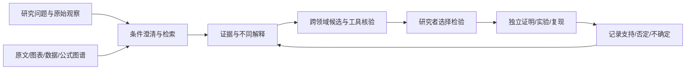

# STTP：科学家研究辅助系统方向调整建议

日期：2026-10-26。性质：方向与研发建议；技术可行性有外部研究支持，STTP 的研究增益及付费需求尚待独立验证。

## 1. 决策建议

建议将项目的产品定位调整为：**以可追溯科学知识为基础，帮助研究人员发现遗漏证据、比较不同解释、迁移跨领域方法，并设计可检验下一步的科研辅助系统。**

图谱继续承担结构化知识、关系检索和证据依赖的底座角色；用户工作的中心转为研究问题、原始观察、候选解释、检验方案和结果回写。公式与数据核验是这套系统的基础能力，上一轮提出的数据修复任务继续有效。

这是一项可分阶段验证的研发方向。可行不等于现有 STTP 已经具备上述能力，更不等于能承诺重大科学发现。近期检验的命题是：在一个限定研究场景中，STTP 能否让研究人员更快找到原来遗漏且确有帮助的证据或方法，并减少错误推断。

建议首个场景：**物理化学中的异常结果解释与跨领域方法检索**。先以已规划的热化学、平衡、单位和条件核验作为基础，再选一个有合作研究者、有原始数据、能在数周内做区分性检验的小问题。具体对象由真实合作课题决定，不能因当前图库某类数据多就反推用户需求。暂不同时进入全部数学、物理、化学子领域。

## 2. 对问题前提的修正与外部证据

知识积累增加学习负担、推动专业化和合作，有研究依据；但“专业越细，所以没有革命性创新”不是本轮证据能成立的因果结论。实验能力、理论工具、资源和研究组织等也可能限制创新。产品应解决可观察的研究阻塞，不以证明科学界停滞为商业前提。

| 原始研究 | 本轮支持的有限判断 | 不能据此推出的结论 |
|---|---|---|
| Jones 的知识负担研究，2005 工作论文，2009 正式发表 [S1] | 知识积累、专业化与合作的联系有理论及经验研究基础 | 单一机制解释所有领域创新变化 |
| Co-Scientist，Nature，2026-05-19 [S2] | 人主导的 AI 假设辅助已有包含实验验证的研究案例 | 所有学科通用可靠，或 STTP 已获得相同效果 |
| AI 与科学关注范围研究，Nature，2026-01-14 [S3] | 观察到 AI 使用与研究关注范围收窄相伴，值得作为产品风险监测 | AI 必然造成收窄；该观察直接等同于当前聊天模型的随机试验 |
| 材料文献嵌入研究，Nature，2019 [S4] | 历史文献可包含可供发现的关联线索 | 相似度或历史回测即可证明一项新发现成立 |

本轮对 S2 阅读了正文、验证说明、局限和数据/代码可得性；对 S3 使用公开摘要及数据/代码说明，未取得订阅正文；S1 使用作者工作论文在 NBER 的检索展示摘要及发表记录，直接页面访问受限；S4 使用原始论文摘要和作者稿检索文本。没有重跑这些论文的实验。S2 论文明确完整系统源码未公开，因此不能声称已独立复现其系统。

对 STTP 的设计推论：要同时优化找到有用知识和保持研究路线多样性。不能只按相似度、引用次数或模型自评分推荐。展示强基线解释、不同机制、证据不足项和可能推翻推荐的结果。

## 3. 当前基础与需要改变的重心

本轮读取了本地 README、开发路线图、上一轮任务单、`viz_server.py` 的接口及状态契约，以及 `elementkg10m_ingest.py` 的导入代码。已有 `/api/search`、`/api/subgraph`、`/api/path`、`/api/nav`、`/api/formula` 和快照身份可作为复用入口，代码存在不代表本轮完成了接口端到端验收。

10 月 24 日审计记录的关键问题仍是本轮规划输入：公式适用条件不足、化学反应信息截断、方向语义、验证器保证范围及复现基线。本轮再次看到导入代码第 129 行对 `REACTION_MAPPED_IS` 执行 `tv[:400]`，该项不能被新愿景绕过。其余旧问题本轮未全部重测，不声称全部保持原状或已经修复。

| 工作内容 | 方向调整 |
|---|---|
| 数据无损导入、来源、条件与版本 | 保留并优先完成，是研究建议可信的基础 |
| 公式、物种、反应、单位与关系图 | 保留，增加条件和证据定位，作为研究任务的辅助视图 |
| 对话/表单检索和局部图 | 保留，扩展为可持续保存的研究工作区 |
| GNN 链接预测、LLM 候选关系 | 暂作为候选线索来源，以真实任务增益决定投入 |
| 规模指标与内部验证得分 | 从主要成果指标降为工程指标，增加任务价值与独立验证 |
| 全图扩张、通用科学聊天模型 | 延后，优先完成一个可复现研究闭环 |

不要仅把原来的节点详情界面改成聊天窗口。需要新增的是研究问题与证据的组织方式、不同解释的比较，以及建议执行后的反馈。

## 4. 科学家实际得到什么

首版提供四类成果：

1. **证据地图**：哪些研究支持某说法，哪些反对；实验条件是否一致；还有哪些关键原件没有取得。
2. **跨领域方法卡**：相邻领域有什么方法可借鉴；变量、结构和边界条件怎样对应；哪些部分不能直接迁移。
3. **候选解释卡**：观察是什么，解释是什么，机制链中哪些环节有证据，哪些只是猜测；保留至少一个有竞争力的替代解释。
4. **下一步检验卡**：测量什么、结果在不同解释下应怎样不同、什么结果会否定候选解释、预计资源需求和未决条件。实验执行方案由负责研究者审查。

候选建议固定包含：研究问题、观察、候选假设、原始证据定位、适用条件、迁移对应关系、反对证据、替代解释、区分性预测、验证方法、验证状态、版本和责任人。

不能把“检索未发现”显示为“从未有人研究”，而应显示检索范围、查询、截止时间和未覆盖资料。文献支持、科学正确、可实施、新颖、值得投入是不同判断，不合成一个未经校准的百分比。

### 示例：反应速率与预期不符

以下仅为交互设计示例，未针对实际实验给出结论。

用户提供速率曲线、实验条件和已有解释。系统先检查单位、测量和样本条件，再检索本征反应动力学、传质限制、测量偏差等不同解释。它展示各解释的适用前提，并帮助研究者选择能区分解释的观测或对照。

从扩散方程等数学结构出发，可以检索其他领域的分析方法，但必须核对变量含义、量纲、边界/初值和耦合项。共享方程形式只支持“存在可考察的方法类比”，不证明物理机制或参数可直接移植。

真正有用的输出是“为何这几个解释值得比较，以及哪一个检验最能排除错误解释”，不是一篇听起来合理的综述。

## 5. 知识和模型如何安排

不需要先拥有全部科学知识，也不应把全部知识压进一个小模型。采用三种不同覆盖策略：公开文献索引提供广度；围绕研究问题按需获取有权访问的原文；在首个领域建设少量深度审核的知识与工具包。摘要不能替代涉及关键结论的原文、图表和方法。

### 建议新增的数据对象

- `ResearchTask`：问题、研究对象、已知观察、约束、目标、可用设备/数据、禁止假定项。
- `EvidenceSpan`：文件内容哈希、版本、页码、图表/段落坐标、原句或数据单元、访问权限、上游来源。
- `Claim`：具体主张、条件、适用范围、支持与反对证据。作者声称不自动提升为系统核验事实。
- `Hypothesis`：候选机制、前提、替代解释、迁移链、可检验预测；默认未验证，不能自动写入已审核事实层。
- `ValidationPlan` 与 `ValidationRun`：预先确定的判据、输入、工具版本、运行结果、人工复核与独立复现记录。
- `ResearchDecision`：研究者采纳/拒绝/延期及原因。采纳不等于正确，失败记录也要保留。

以上是建议新增的接口契约，不宣称仓库已经具有完整实现。现有资料、来源登记和证据对象能扩展的先扩展，避免建立彼此不一致的第二套事实源。

### 技术实现顺序

1. 文档与结构化输入先存不可变原件及权限/版本信息。解析输出与原件分开保存；关键证据能回到页码和图表。GROBID 可用于学术 PDF 的 XML/TEI 结构抽取和坐标定位，但公式、数值表及图像抽取需要另行验证 [S5]。
2. 检索采用全文/关键词、向量和现有图查询组合。可用 PostgreSQL 全文检索与 pgvector，再用排序融合；中文分词及科学符号需用本领域任务验证。pgvector 官方文档给出了混合检索与融合接口方向 [S6]。首版不为规模假设一次引入多套数据库。
3. 模型负责任务解析、检索扩展、候选生成和解释。事实和工具结果来自可追溯数据；模型记忆只作检索线索。设置时间、调用和费用预算，证据不足即停止扩写。
4. SymPy 检查明确假设下的符号关系；pint 用于单位处理；RDKit 检查分子/反应表示；数值脚本检查已定义模型的行为。检查范围分别记录，工具通过不能变成“研究假设已证明” [S7][S8]。
5. 对少量有形式化价值的数学命题再采用 Lean，记录所用公理、依赖和未完成证明。它证明形式化命题，不替研究者证明实际实验符合建模假设 [S9]。
6. 用确定的工作流先完成生成、质疑、验证、汇总四步；多模型/多角色只是候选改进方式，不自动产生独立证据。只有在同预算比较证明有益后，再增加复杂调度。

上述工具为拟议选型。除本轮资料读取外，未在 STTP 中新安装、集成或基准测试这些组件。实施时锁定项目支持的运行环境、工具版本与模型标识。

小模型后置：当任务日志暴露明确瓶颈时，优先训练实体链接、文献相关性排序、条件抽取或工具路由；以独立测试验证是否优于无训练基线。个人实验资料能否用于训练需单独约定，不能因获准检索就默认获准训练。

## 6. 顶尖专家通常会补做、但此前方案没有充分要求的事

以下是建议采用的专家审查方式，不是已经取得的专家评审。

| 专家补做项 | 为什么影响结果 | 如何纳入本次研发 |
|---|---|---|
| 先观察研究者真实卡点和工作过程 | 文献数量大不一定是当前阻塞，可能是设备、测量、模型可辨识性或数据质量 | 前两周收集近期失败/停滞任务，按原因分类，再选择首场景 |
| 对最简单解释与已有最好方法做强对照 | 复杂新解释可能没有超过普通工具的价值 | 每张候选卡保留强基线解释与适用条件 |
| 查否定结果、撤稿/更正、重复发表与共同数据来源 | 一致的文献意见可能来自同一误差或单一实验 | 原文状态与血缘登记；检索反对证据；无法取得负结果时明确缺口 |
| 分析类比的失效边界与参数可辨识性 | 同方程形式、同量纲不足以保证迁移成立 | 方法卡必须有映射、失配与反例，未核对不能标“可直接使用” |
| 优先设计能区分解释的检验 | 仅拟合已有数据可能同时支持多个相互冲突的模型 | 预测差异、控制变量、检验前判据和失败结果均留档 |
| 检查研究路线是否被推荐系统同质化 | 候选很多也可能只是同一种思路改写 | 显示机制差异与来源簇，记录跨任务候选重复；人工审查多样性 |
| 防止用已知答案伪装历史发现 | 模型预训练记忆可能泄漏未来文献 | 历史回测只作辅助；限制检索时间仍不保证无泄漏，必须加前瞻真实任务 |

## 7. 从哪些最原始材料开始

### 当前已经读取的材料

- 本地代码与用户规范：`README.md`、`00_项目管理/开发落地路线图.md`、`06_PoC/viz_server.py`、`11_真实数据/elementkg10m_ingest.py`、四项要求规范。
- 10 月 24 日审计及任务单用于承接发现，属于已有分析记录；本轮未把它们冒充新的全量实验。
- S1–S4 原始研究的可访问文本，及 S5–S9 官方工具说明，访问范围见第 2 节和来源表。

### 首个研究试点必须取得、目前尚未取得的材料

1. 合作研究者正在解决的问题原始描述、近期决策过程、失败案例和可用资源。
2. 相关论文的原版正文、补充材料、原始数值表与图表；不能只提交助手生成的摘要。
3. 测量原始读数、仪器和校准记录、样本/批次、环境条件、实验日志、负结果与数据处理脚本。
4. 使用到的定义、公式原出处、成立前提、代码依赖和计算输入。
5. 上游数据库的未加工记录及版本；针对既有反应问题，回到 `公共数据集/10m_elementkg_release.csv` 的完整对应记录。上游数据库记录仍可能是实验的二次整理，需要保留通往实验论文的来源链。
6. 如要判断商业价值，取得授权的原流程耗时、复核成本、报价反馈和实际付款记录。

用原件哈希、定位、版本和权限形成材料清单。公开可读、允许存储、允许再分发和允许训练分别登记。先验证原始材料是否足以支持任务，再决定入库规模；未取得的原件保留“缺失”，不填编造证据。

## 8. 谁或什么能证明 STTP 有用、建议正确

需要区分三个命题：系统找到有用信息、系统提高研究效率、某个科学假设成立。它们需要不同证据。

### 系统增益：三组对照

先做可行性试点，建议招募 6–10 位相关领域研究者，组织 30–50 个真实任务；这些数量是容量建议，不是统计功效保证。根据先导数据的方差和预期差异再确定正式实验样本量。

- A：研究者使用现有工作流程。
- B：研究者使用相同可用资料的通用模型与普通检索。
- C：研究者使用 STTP 的证据、条件、跨域方法和验证工作流。

任务随机分配并平衡研究者经验；同一研究者避免先看到同一道题的答案再进入另一组。交叉设计用匹配的不同任务并平衡顺序。记录总耗时、复核时间、模型调用费用、遗漏证据和错误结论。对成果隐去系统名称，由未参与开发的两名领域评审独立打分，分歧交第三人裁决。

B/C 的模型、可访问资料、时间和计算预算尽量相同。另做去掉图谱、去掉条件核验、去掉反对证据等消融，以判断哪部分真正增加价值。模型互评只能作辅助，不能作为独立金标准。

### 建议的早期指标

| 指标 | 可核验定义 | 试点使用方式 |
|---|---|---|
| 原文引用支持率 | 实际支持对应主张及条件的引用数 / 已抽查引用数 | 可先设 ≥95% 为质量目标，抽样方案、分母和区间需公布 |
| 有效遗漏线索率 | 前 k 条中研究者原先未记录、独立评审认为相关且正确的线索数 / k | 例如 k=5，与 B 组比较，不能把陌生等同于新发现 |
| 建议可检验率 | 有明确区分性预测和可执行判据的候选数 / 所有候选数 | 与“听起来新颖”的评分分开 |
| 净任务耗时 | 检索、分析、验证及人工复核的总时间 | 沿用中位降低 ≥30% 的试点目标，但不可牺牲错误率 |
| 错误与覆盖 | 错误数及严重程度、完成任务数/总任务数、拒答数 | 独立报告，防止只回答简单任务来提高正确率 |
| 前瞻验证结果 | 预先记录的候选中，实际被独立检验并得到支持/否定/不确定的数量 | 包括全部尝试，防止只展示成功案例 |

以上阈值是拟议目标，不是当前 STTP 成绩。若样本量不足，不用一个百分比宣称显著优越；报告配对差异、区间和失败案例。

### 单项科学结论：证据要离开模型本身

- 数学命题：完整证明和独立检查，必要时使用可信证明内核；明确公理及模型假设。
- 物理/化学机制：在预设条件下对新的观察作出可区分预测，再由独立实验、数据或研究团队检验；测量误差与重复性一起报告。
- 计算结论：独立实现、独立环境和参考案例；同代码再跑一遍主要检验重现性，不能排除共同算法错误。
- 新颖性：可复核的文献检索范围和外部专家判断，只能支持“在已检索范围未发现”，不能证明全球无人做过。
- 商业价值：持续使用、真实付费与可测量净收益；原型点赞和专家称赞不替代。

历史文献回测不能完全消除大模型预训练泄漏，独立专家也可能犯错。最终应积累多种互补证据，并保留推翻原结论的路径。本轮没有获得 STTP 的外部盲评、独立实验成功记录或新增付费证据，因此新方向的效果仍属于待验证命题。

## 9. 建议排期：先把原有修复与新工作流接起来

以下按至少两名工程师、一名能持续参与的领域负责人、兼职学科顾问及独立评审资源可用估计。12–16 周指验证型原型与第一轮试点，正式实验、设备排期和成熟产品另计，不能承诺同期产生科学突破。

| 阶段 | 交付 | 出口条件 |
|---|---|---|
| 第 1–2 周 | 承接 SCI-01–SCI-09 的关键修复；访谈/跟随真实研究任务；冻结首场景、原件清单和对照设计 | 阻断性数据损失可回归；研究者提供可评估问题与材料；不能只用教学演示题 |
| 第 3–5 周 | ResearchTask、EvidenceSpan、Claim；主题证据包；原文定位与支持/反对证据界面 | 关键引用可回到原件；缺条件能澄清；候选不混入事实 |
| 第 6–9 周 | 跨领域方法卡、候选解释卡、工具核验、验证计划及研究工作区 | 完成一个从观察到检验计划的工作流；保留替代解释和检验前判据 |
| 第 10–12 周 | A/B/C 对照、组件消融、独立盲评与错误修复 | 有原始评测记录和失败清单，确认相对普通模型检索有何增益 |
| 第 13–16 周 | 合作团队前瞻检验、结果回写、试点报价和交付复用 | 根据外部结果与真实使用决定扩大、收窄或终止某项能力 |

### 可直接转为开发任务的新增工作

| ID | 优先级 | 内容 | 验收示例 |
|---|---|---|---|
| RA-01 | P0 | 研究问题与原始观察契约 | 问题、条件、原件、目标可保存；缺关键输入不得生成确定建议 |
| RA-02 | P0 | 原文证据定位与版本 | 任一关键主张可定位原件页/图/表；原件更新能标记受影响主张 |
| RA-03 | P1 | 支持、反对、不同条件关系 | 相互冲突的论文在条件不一致时不被简单合并；缺反证不声称没有反证 |
| RA-04 | P1 | 方法迁移与候选解释契约 | 必有变量/条件映射、失配边界与替代解释；无证据对应项标未知 |
| RA-05 | P1 | 数学/单位/化学工具运行记录 | 输入、版本、结果、通过范围与未知项可重放；不能由一个通过项推出整体正确 |
| RA-06 | P1 | 研究工作区前端 | 输入问题→原始证据→解释比较→检验计划→反馈；局部图辅助展开 |
| RA-07 | P0（开工即设计） | 独立评测与前瞻登记 | 隐藏任务、组别预算、盲评表、时间与失败日志、实验前预测留档 |
| RA-08 | P1 | 课题资料权限与结果导出 | 公共/私有资料可区分；授权范围内检索，导出保留证据与版本；训练用途单独登记 |

前端继续高优先级：先给 WorkBuddy RA-01/02/03 的响应样例与状态契约，再实现 RA-06。新服务可提出 `/api/research/tasks`、`/evidence`、`/hypotheses`、`/validation-runs` 等资源，但先审查现有模块可扩展位置；这里不预先强制重写框架。

## 10. 商业与投入的取舍

近期付费交付可以是“某研究问题的证据核验与方法迁移工作区”，包含机构资料接入、证据追踪、团队共享与可复核报告。研究者使用，课题负责人或机构决定采购；技术有用与预算可得需要分别验证。

与普通文献聊天工具的差异必须落实为：条件匹配更准确、能解释为何迁移或不能迁移、反对证据更完整、结果可复现、能接入团队实际数据与后续反馈。若对照实验显示这些没有增加价值，就简化为高质量检索服务，不能仅凭“图谱”和“科学家外挂”名称提高报价。

前期把新增投入放在原始材料、领域研究者、数据修复和独立评测；算力先服务检索与有限候选生成。尚无依据估算这条新路线的收入、估值或发现成功率。原预算不能自动覆盖湿实验、专有数据购买和长周期研究投入，应在首任务确定后单列。

本次建议的近期决策是：**保留现有底座，确立科研辅助的目标；用一个真实课题验证“证据—解释—检验—反馈”闭环，再决定扩学科与训练模型。**

## 来源与核验范围

- [S1：Jones，知识负担，NBER 工作论文](https://www.nber.org/papers/w11360)。检索展示摘要及发表记录；直接页面 403。
- [S2：Co-Scientist 原始研究，Nature 2026](https://www.nature.com/articles/s41586-026-10644-y)。正文、实验概述、局限、数据与代码可用性；未独立复现实验。
- [S3：AI 工具与科学关注范围，Nature 2026](https://www.nature.com/articles/s41586-025-09922-y)。公开摘要及数据/代码说明；观察关联，不作简单因果推断。
- [S4：材料文献中的潜在知识，Nature 2019](https://www.nature.com/articles/s41586-019-1335-8)。原始论文摘要与作者稿检索文本；未重跑材料推荐实验。
- [S5：GROBID 官方文档](https://grobid.readthedocs.io/en/latest/Introduction/)。PDF/TEI 与坐标能力说明；未验证在 STTP 原件上的质量。
- [S6：pgvector 官方文档](https://github.com/pgvector/pgvector)。混合检索与排序融合；未做本项目性能测试。
- [S7：SymPy assumptions](https://docs.sympy.org/latest/guides/assumptions.html)。符号运算与假设边界。
- [S8：RDKit Book](https://www.rdkit.org/docs/RDKit_Book.html)。结构表示与芳香性规则；不代表反应机制验证。
- [S9：Lean 公理与计算](https://lean-lang.org/theorem_proving_in_lean4/Axioms-and-Computation/)。形式系统及公理边界。

本轮实际执行：本地规范/方案/源码读取、原始研究与官方文档检索、方案比较及交付文档编写。未新增模型训练、实验、软件集成、全量测试、独立专家签署或客户付款记录。
