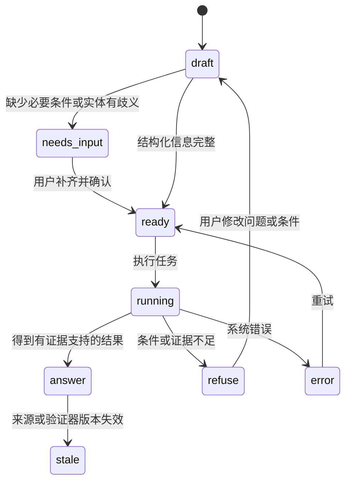
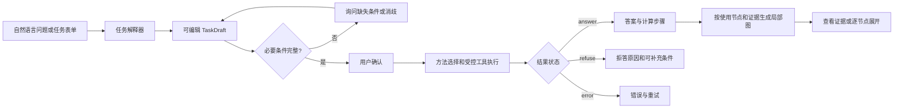
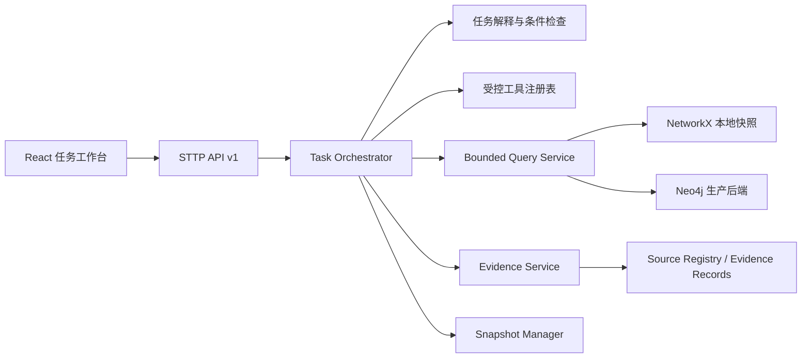

# STTP 任务型前端设计与后台对接规划

版本：v1.0 设计稿  
日期：2026-10-13  
用途：交给 WorkBuddy 作为前端页面、后端 API 和联调实现依据。

## 1. 产品决策

STTP 前端从“打开整张图再寻找内容”调整为“先提出任务，再展示与任务有关的答案、条件、证据和局部图”。

核心规则：

1. 默认首页是任务工作台，不是全图画布。
2. 用户可用自然语言对话，也可填写结构化表单；两种入口统一生成同一个 `TaskDraft`。
3. 浏览器启动时不下载完整图。后端根据任务返回有规模上限的局部子图。
4. 图谱用于解释答案、显示证据关系和继续探索；任务结果是页面主内容。
5. 所有答案、证据和子图必须绑定同一个 `snapshot_id`。
6. 默认排除过期证据和低级模型推断；用户显式开启后才展示。
7. 全图浏览保留在“高级探索”页面，优先级低于任务工作台。

当前完整图约 9,657 个节点、48,712 条边，浏览器技术上可以勉强加载，但全图布局、标签重叠和关系噪声已经使它不适合作为产品入口。未来规模增长后问题会更明显。因此，本方案从 API 层就禁止主页面依赖全图。

## 2. 目标用户与首批任务

第一版面向物理化学学习者、教师和研究助理，先覆盖热力学—化学平衡专题。

首批必须跑通的任务：

- 计算：已知 ΔG° 和温度，计算平衡常数 K。
- 计算：已知 K 和温度，计算 ΔG°。
- 计算或判断：由 ΔH°、ΔS°、T 或 Q 判断相应 Gibbs 能和方向。
- 方法选择：判断应使用 K、Q、ΔG° 或 ΔG。
- 数据查证：查看常量、单位、量纲和来源。
- 证据追踪：解释某个公式、实体映射或关系为什么可信。
- 条件不足：缺温度、物相、标准态、单位或定义域时，请求补充或拒答。

第一版不承担复杂多相平衡求解、动力学模拟、全学科开放问答、自动发表科学结论，以及以连通性替代科学证明。

## 3. 信息架构

### 3.1 页面路由

| 路由 | 页面 | 优先级 | 作用 |
|---|---|---:|---|
| `/workbench` | 任务工作台 | P0 | 默认首页，对话、表单、结果、局部图和证据 |
| `/tasks/:taskId` | 任务详情 | P0 | 可复现地打开历史任务及其绑定版本 |
| `/sources/:sourceId` | 来源详情 | P1 | 查看版本、定位信息、许可和受影响断言 |
| `/explore` | 高级图谱探索 | P2 | 面向专家的实体搜索、有限子图和路径探索 |
| `/settings` | 设置 | P2 | 后端状态、默认可信等级、界面偏好 |

旧的 `06_PoC/graph_view.html` 在迁移期间保留为研发诊断页，不作为新首页，也不在第一阶段删除或重写。

### 3.2 桌面端布局

```text
┌─────────────────────────────────────────────────────────────────────────────┐
│ STTP 任务工作台     数据版本 v…  ●可用     [专题] [高级探索] [设置]        │
├──────────────┬─────────────────────────────┬────────────────────────────────┤
│ 任务历史      │ 对话 / 表单                 │ 结果工作区                      │
│              │                             │                                │
│ 今天          │ 用户问题                    │ [答案] [局部图] [证据]           │
│ · K 与 ΔG°   │ 系统抽取的已知条件           │                                │
│ · 气体常数R   │ 缺失条件 / 假设             │ 结论、计算步骤、单位             │
│              │                             │                                │
│ 示例任务      │ [补充条件] [确认并执行]      │ Cytoscape 局部图 / 证据卡片       │
│              │                             │                                │
├──────────────┴─────────────────────────────┴────────────────────────────────┤
│ 当前任务：answer / needs_input / refuse / stale / error    snapshot: …      │
└─────────────────────────────────────────────────────────────────────────────┘
```

建议桌面宽度分配：任务历史 240–280 px；对话与条件区 420–520 px；结果区占剩余空间，最少 560 px。小于 1180 px 时收起任务历史；小于 860 px 时结果区改为全屏抽屉或上下布局。

### 3.3 页面状态

任务工作台必须明确呈现以下状态：



`refuse` 是科学判断；`error` 是系统故障；`needs_input` 是可继续补充的条件缺失，三者在文字和颜色上必须区分。

## 4. 主任务流程



### 4.1 对话入口

对话输入框用于降低使用门槛，但不能把系统做成一个黑盒聊天窗口。用户提交后，页面先展示可编辑的“条件识别卡”：

- 任务意图：计算、验证、追踪、比较、查路径。
- 目标量或目标实体。
- 已知量：数值、单位、来源。
- 条件：温度、压力、物相、标准态、组成。
- 系统假设：必须显式列出，默认不静默接受高风险假设。
- 缺失条件和实体歧义。

用户确认后才进入执行。若使用 LLM，它只负责产生结构化草稿、解释和候选实体；最终计算、验证状态和证据引用由受控工具完成。

### 4.2 表单入口

在对话框顶部提供“自然语言 / 结构化表单”切换。表单不是独立系统，应与对话共享状态。

推荐字段：

| 字段 | 形式 | 说明 |
|---|---|---|
| 任务类型 | 单选 | 计算 / 验证 / 查证 / 比较 / 证据路径 |
| 目标 | 实体搜索框 | 支持名称、别名、ID 和 LaTeX |
| 已知量 | 可增删行 | 数值、单位、误差和来源 |
| 条件 | 动态字段 | 温度、压力、物相、标准态、组成等 |
| 可信范围 | 默认项 | 默认只使用 `rule_checked` 及以上；特定任务可放宽 |
| 输出偏好 | 多选 | 结果、步骤、局部图、证据、导出记录 |

任务类型变化时动态显示相关字段。不要一次展示全部科学条件。

### 4.3 结果区域

结果区域按下面顺序组织：

1. 一句话结论，以及 `answer / needs_input / refuse / stale` 状态。
2. 已用条件、单位和必要假设。
3. 计算或判断步骤，每一步关联所用公式、节点、边和 evidence ID。
4. 适用范围和不能外推的边界。
5. “查看局部图”和“查看证据”入口。

答案、局部图和证据用页签呈现，但顶部结论和版本状态始终可见。不要把结果藏进聊天气泡深处。

## 5. 局部图设计

### 5.1 局部图的角色

局部图回答三个问题：

- 这个结果使用了哪些实体、公式和关系？
- 它们如何连接到结论？
- 每一步有什么证据，是否仍然有效？

它不负责一次展示所有相关知识。后端负责裁剪，前端负责呈现和按需扩展。

### 5.2 种子与裁剪规则

初始种子按优先级选择：

1. 实际参与计算或判断的节点、边。
2. 支持结论的证据路径。
3. 用户问题识别出的实体和公式。
4. 缺失条件所关联的量、单位和定义。
5. 少量经过验证的一跳上下文。

推荐评分，仅用于裁剪排序，不代表科学可信度：

| 原因 | 展示优先分 |
|---|---:|
| 本次计算或判定直接使用 | +100 |
| 位于答案证据路径 | +80 |
| 用户明确指定 | +70 |
| 系统识别的任务锚点 | +60 |
| `human_reviewed / cross_source` 一跳关系 | +35 |
| `rule_checked` 一跳关系 | +25 |
| `source_asserted` 一跳关系 | +10 |
| `model_inferred` | 默认不加入 |
| `stale / rejected` | 默认排除 |

展示优先分与 `verification_level` 必须是两个字段，前端不能用节点大小或边粗细把二者混成一个“可信度”。

### 5.3 规模预算

| 项目 | 默认值 | 最大值 |
|---|---:|---:|
| 初始节点 | 30–40 | 60 |
| 初始边 | 40–70 | 100 |
| 跳数 | 1–2 | 3 |
| 返回路径数 | 3 | 5 |
| 单次节点展开 | 10 | 25 |
| 整个任务会话节点 | — | 120 |
| 整个任务会话边 | — | 200 |
| 查询时间预算 | 1,500 ms | 3,000 ms |
| 服务端扩展节点预算 | 1,000 | 2,000 |

达到预算时返回 `truncated`，并说明因为节点、边、路径、扩展数还是时间被截断。不得通过 `all_simple_paths()` 无界枚举后再截取结果。

### 5.4 关系白名单

不同任务使用不同关系组合。第一版建议：

| 任务 | 默认关系 |
|---|---|
| 公式与方法选择 | `defines`、`has_symbol`、`has_quantity`、`has_unit`、`uses_operator`、严格的 `derived_from` |
| 量纲检查 | `has_quantity`、`has_unit`、`dimensionally_consistent` |
| 化学反应 | `reactant_of`、`product_of`、`has_element`、`has_quantity` |
| 实体查证 | `same_as`、`defines`、`has_unit`、来源与证据关系 |
| 证据追踪 | 本次答案实际使用的关系及其 evidence；可额外显示替代来源 |

`related_to`、模型候选边和普通引用关系不自动加入推理路径。它们可在高级模式中显示为背景信息。

### 5.5 图交互

- 单击节点：打开详情抽屉，不触发大规模自动展开。
- “展开一跳”：调用后端，展示将新增的数量；超过预算时让用户选择关系类型。
- 单击边：显示语义、方向、验证等级、状态、来源和证据。
- “为什么显示”：说明该元素是计算输入、证据路径、任务锚点还是用户展开结果。
- 支持固定节点、隐藏分支、撤销展开、重置为任务图。
- 支持结果路径高亮和按步骤播放，但播放不是完成任务的必要条件。
- 所有边过滤必须同步影响节点可见性，避免幽灵边和孤立标签。

视觉建议：节点填充色表示学科，形状表示类型；边颜色表示关系类型，线型表示显式/规则/模型来源；验证等级使用小徽标，`stale` 用醒目的琥珀色标识。颜色需配合形状、文字或线型，不能只靠颜色传达状态。

## 6. 组件清单

### 6.1 P0 组件

| 组件 | 责任 |
|---|---|
| `AppHeader` | 项目、专题、后端状态和 snapshot 版本 |
| `TaskHistory` | 历史任务、状态、搜索与恢复 |
| `TaskComposer` | 对话输入、示例问题、上传/粘贴限制提示 |
| `TaskForm` | 结构化字段，与对话共享 `TaskDraft` |
| `ExtractedConditionsCard` | 条件、假设、歧义和缺失字段确认 |
| `TaskStatusCard` | running、needs_input、refuse、error、stale |
| `AnswerPanel` | 结论、步骤、单位和适用范围 |
| `LocalGraph` | Cytoscape 局部图，不接受完整图作为输入 |
| `GraphToolbar` | 关系筛选、布局、复位、展开预算 |
| `NodeDrawer` | 节点详情及“为什么显示” |
| `EdgeDrawer` | 边语义、状态和证据入口 |
| `EvidencePanel` | 证据列表、来源定位、版本和有效状态 |
| `VersionMismatchBanner` | 答案、子图、证据版本不一致时阻断显示 |

### 6.2 P1/P2 组件

- P1：任务导出、分享本地文件、任务对比、来源详情、键盘导航、响应式布局。
- P2：高级探索页、团队评论、候选关系提交、Remotion 动态讲解和视频导出。

Remotion 不进入 P0/P1 主路径。它以后可以读取已完成任务的 `Storyboard`，生成讲解视频，但不能替代任务工作台和 Cytoscape。

## 7. 前端技术方案

推荐：React + TypeScript + Vite，继续使用 Cytoscape.js 和 MathJax；服务端状态使用 TanStack Query；请求/响应使用生成的 TypeScript 类型或 Zod 运行时校验。样式采用 CSS variables 加组件级 CSS，第一版不必引入大型设计系统。

建议目录：

```text
frontend/
  src/
    app/                 路由、全局错误边界、主题
    pages/               WorkbenchPage、TaskPage、ExplorePage
    features/tasks/      对话、表单、任务状态、答案
    features/graph/      Cytoscape、布局、筛选、展开
    features/evidence/   证据与来源
    api/                 API client、类型、SSE
    components/          通用组件
    styles/              tokens、响应式规则
  public/
  tests/
```

第一版采用明亮、中性、科研工具风格；支持系统暗色主题。建议基础色：页面背景 `#F6F8FA`、主文字 `#17212B`、品牌深蓝 `#164E63`、操作色 `#0F766E`。状态色需要固定语义：成功绿、待补充蓝、拒答紫、过期琥珀、系统错误红。

必须满足：键盘可达、焦点可见、ARIA 标签、文本对比度、公式可复制、图谱信息有列表替代表达。局部图不能成为获取证据的唯一途径。

## 8. 后端服务设计

### 8.1 分层



建议新建 FastAPI + Pydantic 服务，旧 `viz_server.py` 保持兼容，不继续承载复杂任务逻辑。查询接口同时支持 NetworkX 和 Neo4j，通过同一服务契约隔离存储差异。

后端模块建议：

```text
backend/sttp_api/
  app.py
  schemas/              TaskDraft、TaskResult、Subgraph、Evidence
  routes/               tasks、graph、evidence、meta
  services/
    task_interpreter.py
    task_orchestrator.py
    tool_registry.py
    subgraph_planner.py
    evidence_service.py
    snapshot_service.py
  repositories/         networkx_repo、neo4j_repo
  tests/
```

### 8.2 API 清单

| 方法与路径 | 用途 | P级 |
|---|---|---:|
| `GET /api/v1/meta/snapshot` | 当前图、验证器、来源登记版本 | P0 |
| `POST /api/v1/tasks/interpret` | 自然语言转成可编辑 TaskDraft | P0 |
| `POST /api/v1/tasks` | 用确认后的 TaskDraft 创建并执行任务 | P0 |
| `GET /api/v1/tasks/{id}` | 获取状态与结果 | P0 |
| `GET /api/v1/tasks/{id}/events` | SSE 推送状态、步骤和完成事件 | P0 |
| `GET /api/v1/tasks/{id}/subgraph` | 获取该任务绑定的初始局部图 | P0 |
| `POST /api/v1/subgraphs/{id}/expand` | 按节点和关系受控展开 | P0 |
| `GET /api/v1/evidence/{id}` | 获取一条证据及来源详情 | P0 |
| `GET /api/v1/entities/search` | 实体搜索与消歧 | P0 |
| `POST /api/v1/paths/query` | 有预算、带语义的路径查询 | P1 |
| `GET /api/v1/sources/{id}` | 来源详情和当前状态 | P1 |

不要为新工作台调用 `/graph_data.json`。该接口只供旧页面和诊断工具使用。

### 8.3 `TaskDraft` 契约示例

```json
{
  "schema": "sttp-task-draft/v1",
  "question": "已知 ΔG°=-33.28 kJ/mol，298.15 K 时 K 是多少？",
  "intent": "calculate_equilibrium_constant",
  "topic": "thermodynamics_equilibrium",
  "entities": [],
  "givens": [
    {"quantity": "standard_reaction_gibbs_energy", "value": -33.28, "unit": "kJ/mol"},
    {"quantity": "thermodynamic_temperature", "value": 298.15, "unit": "K"}
  ],
  "conditions": {"standard_state": true},
  "assumptions": [],
  "missing_fields": [],
  "ambiguities": [],
  "requested_outputs": ["answer", "steps", "subgraph", "evidence"],
  "snapshot_id": "sha256:..."
}
```

若存在歧义，返回候选实体及区分字段；不得替用户静默选择同分子式异构体或不同质子化态。

### 8.4 `TaskResult` 契约示例

```json
{
  "schema": "sttp-task-result/v1",
  "task_id": "task_...",
  "status": "answer",
  "snapshot_id": "sha256:...",
  "verifier_version": "sha256:...",
  "answer": {"value": 678000.0, "unit": "1", "display": "K ≈ 6.78×10⁵"},
  "conditions_used": ["T=298.15 K", "standard state"],
  "steps": [
    {
      "id": "step-1",
      "text": "使用 ΔrG° = -RT ln K",
      "node_ids": ["..."],
      "edge_ids": ["..."],
      "evidence_ids": ["ev-..."]
    }
  ],
  "warnings": [],
  "used_node_ids": ["..."],
  "used_edge_ids": ["..."],
  "evidence_ids": ["ev-..."],
  "subgraph_id": "sg-..."
}
```

`status` 枚举为 `draft / needs_input / ready / running / answer / refuse / stale / error`。数值必须是有限数；JSON 中不得出现 NaN 或 Infinity。

### 8.5 `SubgraphResponse` 契约示例

```json
{
  "schema": "sttp-subgraph/v1",
  "subgraph_id": "sg-...",
  "task_id": "task_...",
  "snapshot_id": "sha256:...",
  "status": "truncated",
  "truncation_reason": "max_edges",
  "limits": {"max_nodes": 60, "max_edges": 100, "max_hops": 2, "deadline_ms": 1500},
  "nodes": [
    {"id": "...", "type": "Formula", "domain": "physics", "label": "...", "why_shown": "used_in_step", "props": {}}
  ],
  "edges": [
    {
      "id": "...", "source": "...", "target": "...", "type": "has_quantity",
      "verification_level": "rule_checked", "status": "valid",
      "evidence_ids": ["ev-..."], "why_shown": "evidence_path"
    }
  ],
  "expandable": [{"node_id": "...", "estimated_neighbors": 18, "token": "opaque-token"}]
}
```

扩展 token 由服务端生成，绑定 task、snapshot、过滤条件和剩余预算。前端不得自行构造无限查询。

### 8.6 统一错误契约

```json
{
  "error": {
    "code": "GRAPH_QUERY_TIMEOUT",
    "message": "局部图查询超时，可减少关系类型或跳数后重试。",
    "retryable": true,
    "request_id": "req-...",
    "details": {"deadline_ms": 1500}
  }
}
```

常用错误码：`ENTITY_AMBIGUOUS`、`MISSING_CONDITION`、`SNAPSHOT_MISMATCH`、`EVIDENCE_STALE`、`SUBGRAPH_LIMIT_REACHED`、`GRAPH_QUERY_TIMEOUT`、`TOOL_EXECUTION_ERROR`。

## 9. 缓存、版本与安全边界

- 所有 API 响应带 `snapshot_id`；任务开始后继续使用该版本，不能中途混入新版图。
- 浏览器缓存键包含 snapshot、task、过滤器和展开 token。
- snapshot 不一致时清空局部图缓存并显示阻断提示，不能把旧答案与新图拼在一起。
- 默认只读；第一版不提供任意 Cypher、任意 Python 或任意文件路径输入。
- 用户输入设长度和结构限制；所有 LaTeX、来源文本和错误内容在前端安全渲染。
- 任务日志不得包含数据库密码、内部路径和完整上游原文。
- 对话解析失败时回退结构化表单，不自动编造字段。

## 10. 性能与可用性验收

| 指标 | MVP 验收目标 |
|---|---|
| 首页数据 | 不请求完整图；首屏业务数据建议 ≤200 KB，不含静态 JS/CSS |
| 初始子图 | 默认 ≤40 节点、≤70 边；硬上限 60/100 |
| 会话子图 | 硬上限 120 节点、200 边 |
| 本地缓存任务查询 | p95 ≤2 秒；超时有明确状态 |
| 版本一致性 | 答案、子图和证据 snapshot 一致率 100% |
| 过期证据 | 默认答案使用数为 0 |
| 证据可达 | 从结果到关键证据最多 2 次操作 |
| 条件缺失 | 缺温度、物相、标准态等必须进入 `needs_input` 或 `refuse` |
| 错误区别 | 无路径、截断、超时、系统错误分别呈现 |
| 无障碍 | 核心流程可键盘操作；状态不只依赖颜色 |

页面加载性能与后端科学任务耗时分开统计。若使用 LLM，另报解析时间和调用失败率。

## 11. 开发优先级与阶段

### Phase UI-0：契约与静态原型，2–3 天

- 冻结本文件中的 TaskDraft、TaskResult、Subgraph、Evidence 契约。
- 制作 5 组固定 fixture：正常答案、缺条件、实体歧义、拒答、证据过期。
- 完成任务工作台桌面与窄屏静态页面。
- 使用 30–40 节点 fixture 验证局部图交互。

退出标准：不连接后端也能完整演示五种状态；页面从未读取完整图文件。

### Phase UI-1：任务 MVP，5–7 天

- 实现 `/workbench`、`/tasks/:id`、对话/表单共享状态。
- 实现条件确认、结果面板、局部图、节点/边抽屉和证据面板。
- 实现 snapshot 条和错误边界。
- 后端实现 meta、entity search、task、subgraph 和 evidence P0 接口。

退出标准：K↔ΔG°、ΔG=ΔH−TΔS、证据查证三个场景可以端到端执行。

### Phase UI-2：有限查询与可信状态，5–7 天

- 实现关系白名单、局部图预算、逐节点展开和截断状态。
- 接入 stale 过滤、来源详情和 bounded path。
- 加入任务事件流、恢复和导出。
- 运行故障注入：超时、版本冲突、坏 evidence ID、超预算和后端不可用。

退出标准：任何查询都不能无界返回；答案和图版本严格一致；过期证据不进入默认答案。

### Phase UI-3：试用优化，3–5 天加用户观察

- 对 5–10 名目标用户开展任务试用。
- 根据真实任务调整术语、表单和信息层级。
- 补充响应式、键盘操作和性能监控。

退出标准：完成时间、错误、证据查看和任务放弃原因可以被记录并分析。

### 暂缓到 P2

- 全图库自由漫游优化。
- 候选关系写回和多人审核。
- Remotion 动态讲解与视频导出。
- GNN 实时推荐和大规模模型推理。
- 复杂权限和组织空间。

## 12. 测试场景

WorkBuddy 至少实现以下测试：

1. 正常任务：ΔG°、T 完整，返回答案、步骤、局部图和证据。
2. 缺温度：进入 `needs_input`，补充后完成同一任务。
3. K≤0、Q≤0、T≤0、NaN/Infinity：拒绝进入计算结果。
4. 同分子式异构体：显示候选，不静默选择。
5. 同量纲不同物理意义：请求语义消歧。
6. 证据过期：结果变为 stale，默认不继续引用。
7. 版本冲突：任务 snapshot 与子图 snapshot 不同，前端阻断组合显示。
8. 高度节点展开：返回截断和可选关系，不冻结页面。
9. 路径超时：显示 timeout，不显示“无路径”。
10. 插入一条 `model_inferred` 边：默认不进入严格证据图。
11. 后端不可用：保留用户已输入内容，允许重试。
12. 页面初始化：网络请求中不出现 `normalized.json` 或完整 `graph_data*.json`。

## 13. WorkBuddy 实施边界

请按以下顺序执行：

1. 先创建 fixture、API 类型和页面原型，提交可检查的页面状态。
2. 再实现后端 `/api/v1`，不要直接把现有 `viz_server.py` 扩成大型服务。
3. 前后端分别通过契约测试后联调。
4. 迁移期间保留旧图谱页面；不改动科学数据和验证结论。
5. 不把完整图复制到前端 public 目录，不新增全量加载兜底。
6. 不在前端重新计算科学结果；前端只显示后端给出的任务步骤和证据。
7. 不把 `confidence` 当作 `verification_level`；不把图路径自动描述成科学推导。
8. 每个 Phase 完成后提供运行命令、截图、接口样例、测试结果和已知限制。

建议新建 `frontend/` 与 `backend/sttp_api/`，避免继续向单文件 `graph_view.html` 和 `viz_server.py` 堆积功能。第一轮只需兼容 NetworkX 本地规范图；接口保持可切换到 Neo4j。

## 14. 最终交付定义

第一版前端完成的标志是：用户无需理解节点 ID，也无需先浏览全图；能够通过对话或表单提交一个热力学任务，确认系统识别的条件，得到可复核的答案或明确拒答，并在有限局部图中查看实际使用的公式、实体、关系和证据。页面不下载完整图，所有内容绑定同一数据版本，查询规模和时间均有硬上限。

