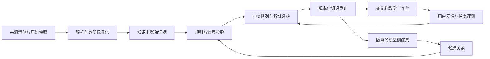

# STTP 项目全面评估与下一阶段研发规划

评估日期：2026-10-09（Asia/Shanghai）  
评估版本：`8a5c977f3ec3e4790e7b59599a75e2f81268b7f6`，main 分支当次克隆版本。  
对象：[zhing99-hash/STTP](https://github.com/zhing99-hash/STTP)  
结论性质：源码审阅、公开资料核验与局部运行验证；商业部分为战略判断与待验证假设。

## 1. 核心判断

**STTP 值得继续研发，但当前最合理的定位是“跨学科知识组织与验证研究原型”。它具备发展成专题教学工作台和科研知识检索工具的基础，尚不能作为可信科学推理平台、自动发现系统或成熟商业产品交付。**

项目的长处已经相当具体：将公式、物理量、单位、元素、分子、反应和文献放入统一图模型；具有数据接入、增量合并、图库部署、可视化、候选关系生成和校验的基本链路；近几轮开发也开始从“增加节点”转向源头修复、跨源核对和连通性审计。这些工作可以复用。

当前制约不只是数据量偏小，而是三个更根本的问题：

1. **科学语义和验证标签尚不可靠。** 本次复现了错误的公式等价、化学守恒和物理量关系被标为 VERIFIED 的情况。
2. **GNN 的现有评估不足以支持泛化能力。** 代码没有真正隔离训练与测试边，且大部分新增可验证边来自规则补全。
3. **从作者本地系统到别人可部署的产品仍有缺口。** 完整快照未随公开仓库交付，依赖未锁定，默认查询和测试依赖缺失数据。

建议下一阶段用约 90 天完成：**可信性修复 → 一个跨数理化的精品专题 → 小范围真实用户与付费试点**。暂缓把百万级扩库、更大 GNN、药物研发和通用 AI 科学发现同时推进。

### 1.1 原规划能否实现

| 规划目标 | 本次判断 | 实现条件 |
|---|---|---|
| 数学、物理、化学统一建图和交互浏览 | 已有基础，技术可行 | 补齐可复现发布与统一数据契约 |
| 真实外部数据接入、实体对齐 | 部分实现 | 区分权威事实、来源主张、自动候选；修复等价关系 |
| 可解释的跨学科学习路径 | 有条件可行 | 用专题任务驱动建库，逐步提供假设、推导步骤和证据 |
| GNN / LLM 提出候选关系并辅助审核 | 可行，价值未证实 | 无泄漏评估、规则基线、人审闭环、成本收益记录 |
| 自动验证任意数学推导、物理规律、化学反应 | 原目标过宽，当前实现不支持 | 必须限定关系类型和验证范围；部分任务需要定理证明或实验 |
| 十万至百万节点知识库 | 工程上可规划 | 数据版本、批处理、索引、分页与性能测试先到位；规模不等于质量 |
| 稳定对外服务、机构交付 | 尚未完成 | 安装、身份与权限、版本、备份恢复、限流、监控及升级机制 |
| 自动产生可信新科学发现 | 无足够证据 | 新颖性核验、专家评审、仿真或实验验证；不能用连边数量替代 |

## 2. 评估范围与证据等级

本次克隆包含 **277 个受 Git 管理文件、106 个 Python 文件**。读取了主 README、知识库路线图、开发指南、最新开发计划、Schema、数据接入规范、验证实现、主要数据适配器、GNN 训练与评测、查询服务、导出和同步脚本，以及关键阶段报告。

采用三种证据口径：

- **本次复现**：运行最小反例、全新克隆 HTTP 冒烟检查、默认路径测试；106 个 Python 文件通过语法解析。
- **源码确认**：能够直接确认代码逻辑，但未在完整生产数据上重跑，如 GNN 训练/评估集合重叠。
- **项目自报**：最新图谱规模、完整图连通性、Aura 对账、PubChem 和文献核验覆盖率，引用仓库报告，本次未独立复算。

**本次没有访问项目 Aura 实例、没有修改图谱、没有重新训练 GNN，也没有重跑全量 ETL。** 最新完整快照和原始大数据未包含在克隆中，因此不能据局部反例推断生产图库受影响边数。商业分析未获得客户访谈、合同、收入、使用日志或真实预算，不能据此确认产品市场匹配、估算公司估值或给出可信 TAM。

检查脚本与原始证据：

- [只读检查脚本](F:/codex/sttp/STTP_review_checks.py)
- [检查结果 JSON](F:/codex/sttp/STTP_review_evidence_20261009.json)

环境：Python 3.12.14；SymPy 1.14.0、pint 0.26.1、RDKit 2026.3.6、NetworkX 3.7。依赖隔离安装在本次评估工作区。测试环境与历史部署不同，版本已记录；报告中的核心反例同时有明确源码依据。

## 3. 当前项目到底建成了什么

### 3.1 现状与历史报告不能混用

最新开发计划和连通性审计报告记载：

| 项目指标 | 最新文档值 | 本次解读 |
|---|---:|---|
| 节点 / 边 | 7,339 / 40,249 | 是作者维护的完整图口径，不是克隆后默认演示数据 |
| Formula | 5,082 | 不应全部解释为经科学验证的定律 |
| Reaction / Molecule | 769 / 755 | 有化学骨架，但反应事实、条件、身份和守恒仍须分层验证 |
| Paper / MathConcept | 181 / 13 | 论文目录已接入，数学概念与推导体系仍薄 |
| Element / Constant / Unit | 118 / 23 / 33 | 元素与物理量底座已形成 |
| 物理 / 化学 / 数学 / 跨学科节点 | 5,246 / 1,791 / 277 / 25 | 物理约 71.5%，不过均衡不应追求机械等分 |
| 跨学科边 | 869，约 2.16% | 需进一步检查可信状态、语义类型和任务贡献 |
| 跨学科边中 has_quantity | 784，约 90.2% | 跨域连接集中于单一关系 |
| 化学—物理跨学科边 | 806，约 92.8% | 数学尚未成为主要连接能力 |
| 连通分量 / 孤立节点 | 1 / 0 | 是忽略方向的结构连通，不能证明推导或因果可达 |

来源：[最新开发计划](https://github.com/zhing99-hash/STTP/blob/8a5c977f3ec3e4790e7b59599a75e2f81268b7f6/00_%E9%A1%B9%E7%9B%AE%E7%AE%A1%E7%90%86/%E4%B8%8B%E4%B8%80%E6%AD%A5%E5%BC%80%E5%8F%91%E8%AE%A1%E5%88%92_20261008.md)、[连通性审计报告](https://github.com/zhing99-hash/STTP/blob/8a5c977f3ec3e4790e7b59599a75e2f81268b7f6/07_%E4%BA%A4%E4%BB%98%E7%89%A9/%E8%B7%A8%E5%AD%A6%E7%A7%91%E8%BF%9E%E9%80%9A%E6%80%A7%E5%AE%A1%E8%AE%A1%E6%8A%A5%E5%91%8A_20261009.md)。所有上述完整图数字均为**仓库报告值**。

真正的进步是把错误的标签、孤儿反应、命名空间、元素属性等问题追到源头，配合增量和对账修复。这说明项目已经积累实际工程经验。

但“13 个子领域有切片”“单个连通分量”“40,249 条边”分别只能说明覆盖骨架、结构连通和记录规模，不能证明知识完整、推理有效或教学有效。尤其 `connectivity_audit.py` 的并查集合并忽略方向，也不按证据等级筛边；它测到的是**弱连通结构**。源码：[连通性审计实现](https://github.com/zhing99-hash/STTP/blob/8a5c977f3ec3e4790e7b59599a75e2f81268b7f6/06_PoC/connectivity_audit.py#L70)。

### 3.2 数据源分工及其能力边界

| 来源 / 内容 | 当前可用价值 | 必须保留的边界 |
|---|---|---|
| 人工 seed 切片 | 可控、便于编排课程与回归 | 默认 curated_seed、confidence=1.0 并不构成专家复核证明 |
| PhysicsBabel | 提供量纲约束下的方程候选空间 | plausible 不是科学定律认证，应进入候选库 |
| ElementKG 及化学子图 | 元素、分子、反应、官能团关联 | 原始版本、下载位置、身份对齐与许可需可核查 |
| PubChem | 通过标识符补属性和交叉核验 | 标识符匹配不验证全部反应；来源字段可能有不同使用条件 |
| CODATA / NIST | 常量值、单位、不确定度和版本 | 应区分定义精确值、实验测量值及相关适用条件 |
| OpenAlex / Crossref / DataCite | 文献元数据、引用和 DOI 身份核验 | DOI 命中不证明论文内容正确；引用关系不等于公式推导 |
| ChEMBL | 分子属性和药学标签补充 | 未形成靶点—活性实验—条件—证据的完整药研工作流 |
| Wikidata | 标识符和概念对齐候选骨干 | 不能作为所有科学关系的最终真值，且暂未全面真实落地 |

OpenAlex 的当前适配器把文献连向主题概念，`discusses` 按 primary_topic 映射，标为 inferred 和 0.7；这部分处理方向是诚实的。但它没有完成论文公式抽取、符号绑定和推导链抽取，因此不能将“新增数学论文”当作“数学公式库已补齐”。源码：[OpenAlex 构图实现](https://github.com/zhing99-hash/STTP/blob/8a5c977f3ec3e4790e7b59599a75e2f81268b7f6/11_%E7%9C%9F%E5%AE%9E%E6%95%B0%E6%8D%AE/openalex_ingest.py#L271)。

PhysicsBabel 官方数据卡明确说明它由机器生成量纲关系，量纲分析不证明物理存在，也无法确定无量纲系数。应修正 README 的“真实物理方程”表述，并将来源真实性与内容真实性分开。[PhysicsBabel 官方数据卡](https://huggingface.co/datasets/RANDMEDIATION/PhysicsBabel)

### 3.3 项目结构评价

| 目录 | 实际职责 | 评价及建议 |
|---|---|---|
| 00_项目管理 | 路线图、下一步计划、执行记录 | 历史记录丰富；建立唯一当前路线图与验收表 |
| 01_架构与数据模型 | Schema、字典、技术基线 | 转为可执行契约；文档不得独立漂移 |
| 02_数据层 | ETL 与接入设计 | 与实际分散适配器建立明确对应 |
| 03_知识层 | Neo4j、NetworkX、Kuzu 与查询 | 保留统一查询抽象，减少重复加载器 |
| 04_验证闭环 | 候选生成、三类校验 | 核心资产候选，也是当前优先修复对象 |
| 05_可视化 | 原型设计 | 与 06 中实际前端职责分离 |
| 06_PoC | 导出、服务、构建、修复、审计、测试 | 已承担主应用，名称和责任范围不再匹配 |
| 07_交付物 | 各阶段报告 | 保留归档；由运行产物生成指标，避免手写不一致 |
| 08_部署包 | Docker / Neo4j 安装材料 | 避免复制加载器与旧数据导致版本分叉 |
| 09_科研扩展 | GNN、对齐、推理、同步编排 | 实验代码与正式服务隔离，模型产物带版本 |
| 10_种子数据 | 人工专题知识切片 | 改为有来源、审核记录和学习目标的知识包 |
| 11_真实数据 | 外部适配器、核验、修复 | 按 source manifest 管理，不再以“真实”统括不同可信等级 |

本次未发现 AGENTS.md，也未发现受 Git 管理的 requirements、pyproject、依赖锁文件或 GitHub Actions 配置；这不代表仓库没有任何测试。仓库已有前端路径测试、离线渲染测试和若干验证脚本，但尚未形成可重复运行的完整发布门禁。

当前 Phase 编号同时承担研究阶段、数据快照版本和历史修复序号，存在语义混用。例如路线图 Phase 9 指向 Wikidata 对齐，代码目录 `9_inference` 却指向推理层，当前快照已到 phase24。建议保留历史名称，将今后工作统一写成产品版本和能力里程碑，如 `v0.2-trust`、`v0.3-topic`、`v0.4-pilot`。

## 4. 必须先处理的技术和科学问题

优先级：P0 = 对“可信知识/已验证”的核心承诺造成直接破坏；P1 = 阻碍可靠交付或扩大后果；P2 = 后续完善。这里的 P0 不等同于已经发生生产安全事故。

### 4.1 P0：PhysicsBabel 将整式量纲齐次误写为两个量之间量纲一致

`physicsbabel_ingest.py` 读取公式后，取前两个参与量建立 `dimensionally_consistent`，直接写入 `verified=True`，而没有验证两个端点的量纲相同。

**本次复现**：用一条代表 `F=k·m·a` 的模拟源记录调用真实接入函数，得到：

`PQ:mass → PQ:accel [dimensionally_consistent, verified=True]`

质量的量纲是 M，加速度是 L·T⁻²；整式左右量纲相同不能推出质量与加速度量纲相同。此外，代码把 `exponents[k]` 保存为 quantity 的 `dimension`，但这个值表示该量在当前无量纲单项式中的指数，并不是该量的七维 SI 量纲向量。

**修复**：参与关系改为 `uses_quantity`；为公式建立独立的量纲验证记录；Quantity 的七维量纲来自受控字典；原始指数保留在公式变量绑定上；回溯所有由这条规则生成的旧边。位置：[PhysicsBabel 接入实现](https://github.com/zhing99-hash/STTP/blob/8a5c977f3ec3e4790e7b59599a75e2f81268b7f6/11_%E7%9C%9F%E5%AE%9E%E6%95%B0%E6%8D%AE/physicsbabel_ingest.py#L29)。

### 4.2 P0：公式字符串清洗被当成数学等价证明

`norm_latex()` 删除全部 LaTeX 命令，再转小写。因此：

| 输入一 | 输入二 | 当前归一化结果 | 实际后果 |
|---|---|---|---|
| `\sin(x)` | `\cos(x)` | 两者都为 `(x)` | 实际 gate 返回 same_as / VERIFIED |
| `\alpha+x` | `\beta+x` | 两者都为 `+x` | 不同变量信息消失 |
| `E=mc^2` | `e=mc^2` | 两者都为 `e=mc^2` | 大小写敏感符号混淆 |

这会污染对齐、去重、路径与训练样本。**应立即取消该字符串规则自动授予 VERIFIED 的权限**；字面相似只能作为检索候选。等价判断至少需要表达式 AST、变量作用域与假设域；无法解析时进入 UNKNOWN / 待审核。位置：[公式归一化规则](https://github.com/zhing99-hash/STTP/blob/8a5c977f3ec3e4790e7b59599a75e2f81268b7f6/09_%E7%A7%91%E7%A0%94%E6%89%A9%E5%B1%95/9_inference/gnn_infer.py#L503)、[公式等价门控](https://github.com/zhing99-hash/STTP/blob/8a5c977f3ec3e4790e7b59599a75e2f81268b7f6/09_%E7%A7%91%E7%A0%94%E6%89%A9%E5%B1%95/9_inference/gnn_infer.py#L575)。

### 4.3 P0：校验器未明确“验证范围”

**化学反例已复现**：

- `CO>>C=O` 被判 VERIFIED。按分子 SMILES 的通常意义，甲醇与甲醛氢数不同；当前只数显式原子节点，未做完整氢守恒。
- `[Na+]>>[Na]` 被判 VERIFIED。未声明电子或外部电荷来源时，总电荷不守恒，但当前没有电荷检查。
- 即使原子、电荷和计量完全守恒，也只能证明必要条件，不能证明反应在给定条件下发生、具有相应选择性或产率。

**数学反例已复现**：`sqrt(x**2)=x`，调用者只给出变量 x，代码隐式将所有变量设为正实数，随后返回“等式恒成立”。正确结果应显式附加 x≥0 的条件；任意实数域应是 `sqrt(x²)=|x|`。没有证明成功也不能一律视为已证明错误，需区分 DISPROVED 和 UNKNOWN。

**物理反例已复现**：GNN gate 对 molecule / quantity，只要能算出摩尔质量且 quantity 名称含 mass、weight 或 energy，就可返回 VERIFIED。用水的摩尔质量与名为 energy 的 quantity 测试，也得到 VERIFIED；它并没有给出能量的数值、物理模型或单位核验。

**修复**：拆开语法有效、维度齐次、计量守恒、符号等价、来源核对、专家审核、实验验证。每条 Verification 必须记录方法、输入、假设、范围、版本和结果，不再用一个布尔值包办科学可信性。位置：[化学原子计数](https://github.com/zhing99-hash/STTP/blob/8a5c977f3ec3e4790e7b59599a75e2f81268b7f6/04_%E9%AA%8C%E8%AF%81%E9%97%AD%E7%8E%AF/verification_loop.py#L86)、[数学变量假设](https://github.com/zhing99-hash/STTP/blob/8a5c977f3ec3e4790e7b59599a75e2f81268b7f6/04_%E9%AA%8C%E8%AF%81%E9%97%AD%E7%8E%AF/verification_loop.py#L283)、[摩尔质量门控](https://github.com/zhing99-hash/STTP/blob/8a5c977f3ec3e4790e7b59599a75e2f81268b7f6/09_%E7%A7%91%E7%A0%94%E6%89%A9%E5%B1%95/9_inference/gnn_infer.py#L570)。

### 4.4 P0：化学实体不能仅凭分子式 same_as

ElementKG 适配器按分子式匹配骨架 PubChem ID，然后生成 `same_as`。例如映射表包含 `C2H6O → PC:mol:702`，分子式相同的另一种结构也能走入这条身份关系。

本次用 RDKit 验证：乙醇 `CCO` 与二甲醚 `COC` 都是 C₂H₆O，但结构不同。类似问题还包括立体异构、盐型、质子化、同位素和混合物。

**修复**：分子式只生成 `same_formula_as` 或候选匹配；精确身份优先采用经约定标准化后的完整 InChIKey / 规范结构，并对盐型、互变异构、立体信息分别定义关系。不能把“去掉重复节点”作为比“保存科学差异”更高的目标。位置：[分子式对齐规则](https://github.com/zhing99-hash/STTP/blob/8a5c977f3ec3e4790e7b59599a75e2f81268b7f6/11_%E7%9C%9F%E5%AE%9E%E6%95%B0%E6%8D%AE/elementkg10m_ingest.py#L206)。

### 4.5 P0：GNN 当前指标属于训练内评价，不能用于宣称发现能力

源码流程是：

1. 将所有符合条件的关系边加入训练集合，仅对 has_symbol 下采样。
2. 用全图构建邻接、度、出入关系计数和端点模式。
3. 训练结束后，再从同一批 `edge_by_type` 随机抽取 10% 做评估。

**这是明确的训练/评估重叠**。除下采样的 has_symbol 外，评估正样本已被训练；即使以后只从 loss 中移除测试边，全图邻接和关系计数仍会泄漏测试结构。源码：[GNN 训练样本构造](https://github.com/zhing99-hash/STTP/blob/8a5c977f3ec3e4790e7b59599a75e2f81268b7f6/09_%E7%A7%91%E7%A0%94%E6%89%A9%E5%B1%95/9_inference/gnn_infer.py#L126)、[GNN 全图结构特征](https://github.com/zhing99-hash/STTP/blob/8a5c977f3ec3e4790e7b59599a75e2f81268b7f6/09_%E7%A7%91%E7%A0%94%E6%89%A9%E5%B1%95/9_inference/gnn_infer.py#L157)、[GNN 评估实现](https://github.com/zhing99-hash/STTP/blob/8a5c977f3ec3e4790e7b59599a75e2f81268b7f6/09_%E7%A7%91%E7%A0%94%E6%89%A9%E5%B1%95/9_inference/gnn_infer.py#L321)。

此外，评估对每个正样本采 250 个随机尾节点，允许重复，也不限制为同类合法端点。因此它是“250 随机负样本口径的排序指标”，不能与全候选、类型约束的 filtered MRR 直接比较。负例过容易也会抬高表现。

文档报平均 MRR **0.7391**，当前提交的 JSON 是 **0.7037**，两者没有足够 run ID / 数据哈希解释差异。与其选择一个对外展示，更应在修正评测后重建可信基线。[GNN 阶段报告](https://github.com/zhing99-hash/STTP/blob/8a5c977f3ec3e4790e7b59599a75e2f81268b7f6/07_%E4%BA%A4%E4%BB%98%E7%89%A9/GNN%E5%B8%A6%E7%B1%BB%E5%9E%8B%E8%BE%B9%E9%87%8D%E8%AE%AD%E6%8A%A5%E5%91%8A_20261008.md#L108)、[GNN 提交指标文件](https://github.com/zhing99-hash/STTP/blob/8a5c977f3ec3e4790e7b59599a75e2f81268b7f6/09_%E7%A7%91%E7%A0%94%E6%89%A9%E5%B1%95/9_inference/phase13_gnn_metrics.json)

**修复**：

- 先去重和分组，再按来源 / 时间 / 实体族划分 train、validation、test；same_as、逆向边及同一公式变体不得跨集合泄漏。
- 只用训练图构建邻接与结构特征；端点约束来自人工维护的 Schema，不从混有错误的全图“学合法性”。
- 报告类型约束的全候选排名，或清楚标记采样口径；补充分组 Precision@K、Recall、覆盖率和置信区间。
- 对比规则、词法/语义检索及简单图方法；做 rules-only / GNN-only / combined 消融。
- 用独立标注集验证模型增量收益，不将 sigmoid 分数直接解释为正确概率。

### 4.6 P1：大量 VERIFIED 新边是规则补全，不是模型发现

提交产物有 3,600 条边，其中 3,404 标为 VERIFIED；Part B 的规则生成记录合计 **3,381 条**。Part A/B 存在合并去重，不能简单相加，也不能用 3,404/3,600 当作“GNN 科学准确率 94.6%”。

这不是否定规则：解析分子组成、核对摩尔质量，本来就是高性价比的知识补全。但若直接规则已经能确定答案，就应直接运行规则，而不是把同一结果包装为模型发现。真正需要证明的是：**相同专家审核预算下，GNN 比规则+检索多找到多少条正确、有用、已有方法漏掉的关系。**[GNN 提交指标文件](https://github.com/zhing99-hash/STTP/blob/8a5c977f3ec3e4790e7b59599a75e2f81268b7f6/09_%E7%A7%91%E7%A0%94%E6%89%A9%E5%B1%95/9_inference/phase13_gnn_metrics.json)

### 4.7 P1：公开交付不可直接复现最新状态

本次全新克隆实测：

| 检查 | 结果 |
|---|---|
| 106 个 Python 文件语法解析 | 通过；不等同于运行测试全通过 |
| 提交的默认 graph_data.json | 22 节点 / 52 边 |
| normalized / with_inferred / phase24 | 均未包含 |
| HTTP 首页、graph_data、stats | 返回 200，基于旧演示图或降级 |
| HTTP neighbors | 返回 503，因查询原始图缺失 |
| 默认 a3_path_harness.cjs | 退出码 1：找不到任何 phaseN 快照 |
| GNN 默认数据源 | 硬编码 phase13 / phase12，本次克隆均不存在 |
| requirements / pyproject / lock / GitHub Actions | 未发现受版本管理的对应文件 |

大文件不放 Git 是合理选择；缺少的是可下载、有校验和、许可清晰的 release 数据包与重建入口。README 的快速开始还要求用户自己提供 `<your_graph.json>`，并未把最新能力变为开箱可复现。[README](https://github.com/zhing99-hash/STTP/blob/8a5c977f3ec3e4790e7b59599a75e2f81268b7f6/README.md)、[数据排除清单](https://github.com/zhing99-hash/STTP/blob/8a5c977f3ec3e4790e7b59599a75e2f81268b7f6/.gitignore)、[服务数据源选择](https://github.com/zhing99-hash/STTP/blob/8a5c977f3ec3e4790e7b59599a75e2f81268b7f6/06_PoC/viz_server.py#L112)、[默认路径测试](https://github.com/zhing99-hash/STTP/blob/8a5c977f3ec3e4790e7b59599a75e2f81268b7f6/06_PoC/tests/a3_path_harness.cjs#L26)

建议最少提供三个包：小型离线 demo、可信专题 release、完整研究数据重建清单；统一 `python -m sttp demo / validate / serve`，按 core、chem、ml、dev 分组锁依赖。

### 4.8 P1：演示投影、查询与训练之间存在事实口径分叉

当前前端数据可以由 GRAPH_DATA_FILE 指向某个 phase，但后端查询单独优先读取 with_inferred，再读取 normalized，且启动后缓存为内存对象。它们可能不是同一 release；一次改动可能只更新其中一份。

GNN 还从“可视化格式”读取数据，而 graph_export 对边仅透传固定字段，未完整保留来源、验证版本、时间和状态。这会把展示格式当成训练事实源，降低审计性。[服务数据源选择](https://github.com/zhing99-hash/STTP/blob/8a5c977f3ec3e4790e7b59599a75e2f81268b7f6/06_PoC/viz_server.py#L112)、[边投影字段](https://github.com/zhing99-hash/STTP/blob/8a5c977f3ec3e4790e7b59599a75e2f81268b7f6/06_PoC/graph_export.py#L217)

建议所有消费者读取相同 manifest 的 release_id 和 hash。图展示是派生投影；模型、验证器、API 从同一规范数据层取数。刷新采用整版原子切换，并让 API 显式返回数据版本。

### 4.9 P1：规模化服务和同步流程尚未达到生产要求

- NetworkX 查询把所有 5 跳以内简单路径转成 list，没有数量上限和时间预算；节点不多也可能因局部组合爆炸而耗尽请求资源。应改为有界 top-K 搜索、语义关系过滤和超时。[NetworkX 路径枚举](https://github.com/zhing99-hash/STTP/blob/8a5c977f3ec3e4790e7b59599a75e2f81268b7f6/03_%E7%9F%A5%E8%AF%86%E5%B1%82/queries.py#L165)
- 普通图路径只表示关系串联。单位桥、same_as、has_quantity 串起来不自动构成数学推导、学习先修链或因果解释。
- reconcile 默认会删除云端独有边；若本地快照旧、不完整或多人并发使用，就可能把合法新数据当残留删掉。最终 `ok=False` 时仍可返回 0，也不足以担当发布门禁。建议默认只报告；执行须绑定 base hash、备份和计划，最终复读集合/属性校验失败即非零退出。[云端对账行为](https://github.com/zhing99-hash/STTP/blob/8a5c977f3ec3e4790e7b59599a75e2f81268b7f6/06_PoC/reconcile_aura_edges.py#L78)
- 长期保留 NetworkX 做小图测试即可；生产选定一个主图库。当前体量没有必要同时投入 Neo4j 集群、双活、Kuzu 和复杂微服务。
- 将来对外接收表达式时，不可直接把任意输入交给 SymPy parse_expr；应限制语法、隔离执行并限制资源。此项是服务化前置条件，并非声称当前 localhost 演示已暴露公网漏洞。[SymPy 官方解析文档](https://docs.sympy.org/latest/modules/parsing.html)

### 4.10 P1：文档、来源和事实版本治理需加强

ROADMAP、开发指南、阶段报告中同时存在历史数量与最新数量，以及不同的“已完成”口径。历史测试报告可证明当时演示运行过，不能覆盖当前模型、数据与新增功能。

建议建立一份机器可读 release manifest，自动生成当前状态页；每份实验与报告绑定 code commit、input hash、schema、validator/model version、run ID 和评估配置。数据接入必须记录来源版本与许可，第三方可核验的下载入口与哈希应成为交付门槛。


## 5. 知识库建设路线：从“记录集合”转向“可审查的知识主张”

### 5.1 重新定义知识对象

保留现有 Formula、Quantity、Molecule、Reaction 等实体，但补充三个关键对象：

| 对象 | 应保存的内容 | 解决的问题 |
|---|---|---|
| Claim / 知识主张 | 主体、关系、客体、适用条件、状态、有效版本 | 同一关系在不同来源或条件下可能成立、冲突或未知 |
| Evidence / 证据 | 具体文献/数据记录、页码/公式号/段落、获取时间、内容哈希、许可 | 仅 source='curated_seed' 无法追溯原始依据 |
| Verification / 验证记录 | 输入快照、方法、工具版本、假设域、结果、覆盖范围、审核者 | 把“何种检查通过”与“事实整体可信”分开 |

每个公式还需要结构化符号绑定：符号名字、所属公式/文献作用域、所指物理量、单位、变量域及维度。不要将所有写作 E、k、R 的符号强行合并；同一符号在不同学科或文献中可以含义完全不同。

每个数值属性需要 value、unit、uncertainty、conditions、method、source/version。分子量是属性；“在某温度、压力、溶剂下测得某性质”应成为有条件的观测记录，不宜永远覆盖在一个固定节点属性上。

`same_as`、`equivalent_under`、`same_formula_as`、`related_to` 和 `is_special_case_of` 必须分别定义，禁止互相替代。Reaction 的 reactant_of/product_of 方向也要由契约确定，迁移历史反向边，不能用现有脏数据推导合法方向。

### 5.2 三个发布层，明确不同用途

| 发布层 | 内容 | 产品使用规则 |
|---|---|---|
| Trusted | 来源定位完整、语义契约通过、该范围内完成审核的主张 | 教学与默认回答优先使用，仍展示条件与证据 |
| Supported | 有明确来源或局部自动检查，但语义/适用性尚未完成审核 | 可以作为资料和辅助线索，明确验证边界 |
| Hypothesis | GNN、LLM、量纲枚举、模糊对齐产生的候选 | 默认不参与确定性回答，不计入可信覆盖率 |

新增数据先进入 staging / quarantine，执行类型、身份、来源、条件与冲突检查，再决定发布层。所有模型生成内容保留原始提议，审核后的主张独立版本化；禁止把模型输出自动变成下一轮训练真值而不留轨迹。

### 5.3 推荐的入库和发布流程



这里不要求立即新建大量微服务。初期在一个模块化 Python 应用中，通过独立的数据表/节点类型和流水线阶段实现即可。

### 5.4 首个精品专题：热力学—化学平衡—数学方法

选择理由：它与已有 TH、CE、CODATA、分子和单位层最接近，能自然连接三学科，且任务可以被教师清楚判断对错，不必依赖稀缺实验数据。

首批覆盖五条“有内容的连接链”：

| 任务链 | 数学贡献 | 物理贡献 | 化学贡献 |
|---|---|---|---|
| 化学势与平衡常数 | 对数、指数、正值域 | 温度、气体常数、自由能 | 活度、反应商、平衡常数 |
| 温度对平衡的影响 | 导数、积分、近似 | 焓、热容量 | van 't Hoff 关系及适用范围 |
| 反应速率 | 微分方程、拟合 | 温度与能量尺度 | 一/二级动力学、Arrhenius 参数 |
| 物料与能量守恒 | 线性方程组、化学计量矩阵 | 质量、能量守恒 | 配平、反应热与物料衡算 |
| 稀溶液近似 | 泰勒展开、误差界 | 近似模型与误差 | 活度和浓度近似的边界 |

一条示范任务可以是：“为什么平衡常数随温度变化？这个公式在什么条件下能用？”

答案链应包含：
- 反应、计量系数和活度定义；
- `ΔrG = ΔrG° + RT ln Q`；
- 平衡时 `ΔrG=0`、`Q=K`，因此 `ln K=-ΔrG°/(RT)`；
- 若继续给出温度导数，说明标准态和采用的热力学关系；积分简式还需说明焓随温度变化的近似；
- T 用绝对温度，Q/K 按标准态定义为无量纲，不能直接对带单位浓度取对数；
- 每一步绑定来源位置、假设和验证范围。

交互展示应当优先呈现这条可读论证链，再允许打开相关图谱。不能把“分子 → 物理量 → 公式”的最短路径直接显示为上述推导。

### 5.5 分批建设而非并行吞入所有大库

| 建设批次 | 建议范围 | 完成标准 |
|---|---|---|
| 第 0 批：修复和重分层 | 审计现有 PB 候选、same_as、VERIFIED、反应方向 | 高风险规则停止自动提升，已知错误可追溯撤回 |
| 第 1 批：精品专题 | 建议 150–300 个经审核公式/概念，50 个真实用户任务 | 来源、符号、条件和解释完整；数量是预算上限参考 |
| 第 2 批：量与单位底座 | 专题实际用到的 Quantity、Unit、Constant | 七维量纲和单位规范，数值版本和精确性明确 |
| 第 3 批：文献到具体主张 | 先选 20–50 篇可合法使用、可定位公式的文献 | 文献→公式/主张→证据位置可追溯，拒绝只增加 Paper |
| 第 4 批：邻接专题扩展 | 电化学或传输/动力学二选一 | 可复用至少大部分契约和流程，新增任务有用户需求 |
| 第 5 批：规模化和开放接口 | 由机构需求决定数据量和刷新频率 | 质量、成本、时延和许可门禁持续达标 |

**不建议用强行降低物理节点占比或提高跨域边比例作为目标。** 这些是诊断指标。主动删除合法知识、把单位和性质重新标成其他学科，都可能美化比例但不改善产品。应首先把机器枚举候选与已验证事实分开，再评价目标任务涉及的三学科知识是否完整。

### 5.6 北极星指标重设

推荐北极星指标：

**目标任务可信完成率 = 在固定目标任务集上，结论正确、条件完整、证据可追溯且用户能够使用的任务数 ÷ 全部任务数。**

失败、拒答和缺资料均保留在分母，避免通过拒答筛走难题；另行报告覆盖率与错误回答率。用任务复杂度分层，冻结测试集，避免改口径掩盖回退。

辅助指标建议：

| 维度 | 指标 | 建议试点门槛，不是当前实绩 |
|---|---|---|
| 数据契约 | 悬空边、重复 Claim ID、非法方向 | release 中为 0 |
| 证据 | Trusted 主张来源位置与版本覆盖 | 100% |
| 科学验证 | 已知反例误升 VERIFIED | 固定反例集为 0 |
| 内容准确 | 独立专家抽样可接受比例 | ≥95%，同时报告样本量和置信区间 |
| 任务完成 | 50 个固定任务可信完成率 | ≥80%，按学科链分组 |
| 效率 | 相对原有备课/检索流程的耗时中位数 | 下降 ≥30%，用成对任务验证 |
| 模型增量 | 相同审核预算下的新增正确关系 | 超过 rules+检索基线，否则暂停模型扩容 |
| 运行 | 指定硬件/数据量/并发下查询 P95 | 搜索/邻域 <2 秒；复杂任务异步 |
| 运维 | 发布重建、失败退出、备份恢复 | CI 与演练均可复现 |
| 商业 | 有预算、有验收人、有付款的试点 | 首轮争取 1–2 家，不能用口头认可替代 |

“反例集为 0”只表示这些已知缺陷被封堵，不等于证明系统没有其他错误。

## 6. 技术发展方向与目标工程结构

### 6.1 延续图谱架构，但调整优先顺序

推荐研发顺序：

1. 证据和语义契约；
2. 确定性解析、单位/条件检查、来源核验；
3. 任务检索和可读解释；
4. 人工审核工作台；
5. 有基线的 GNN / LLM 候选生成；
6. 按实际负载扩展存储和算力。

近期 GraphSAGE + ComplEx 可以留作实验基线。先修评测，不宜直接更换更大的模型。公式应使用 AST/运算结构与符号绑定，反应需计量与参与物角色；仅靠节点类型、度和出入边计数很难理解推导意义。

LLM 适合把自然语言请求映射成受控查询、提出候选、组织解释。校验结果和来源不能由 LLM 自述代替。当前 Phase 3 默认候选来自 heuristic 目录，Phase 9 的 llm_hypotheses / llm_review 主要是模板、规则和白名单逻辑；虽然有 API 扩展入口，不能将这些脚本的产出全部描述为真实 LLM 独立复核。[Phase 3 候选生成器](https://github.com/zhing99-hash/STTP/blob/8a5c977f3ec3e4790e7b59599a75e2f81268b7f6/04_%E9%AA%8C%E8%AF%81%E9%97%AD%E7%8E%AF/llm_hypothesis.py)、[Phase 9 规则筛选](https://github.com/zhing99-hash/STTP/blob/8a5c977f3ec3e4790e7b59599a75e2f81268b7f6/09_%E7%A7%91%E7%A0%94%E6%89%A9%E5%B1%95/9_inference/llm_hypotheses.py#L45)

### 6.2 建议逐步收敛到一个模块化项目

```text
src/sttp/
  schema/          节点、关系、Claim、Evidence、迁移
  sources/         各外部来源适配器和标准化
  identity/        实体对齐、作用域、候选去重
  validation/      数学、物理、化学校验与结果契约
  graph/           存储、索引、查询、图投影
  inference/       规则与模型候选生成，和训练隔离
  review/          专家审核、冲突、撤回
  api/             有界只读 API 与鉴权
  cli/             build / validate / serve / release
apps/web/          教学/检索/图谱/证据交互
data/manifests/    来源、许可、快照哈希和发布描述
data/fixtures/     小型合法可分发的回归样本
benchmarks/       冻结任务、金标准、负例和评测配置
tests/            科学反例、ETL、查询、发布与端到端
docs/             当前文档、ADR、历史归档
experiments/      研究脚本与实验配置
```

这是一条渐进迁移路线，不是要求推倒重写：先统一导入路径、配置、数据契约和 CLI，再搬移模块，保留旧脚本的兼容入口。Neo4j 和 NetworkX 暂时可以满足不同职责；选择其他数据库应依据实测查询、部署成本和维护状况，而不是增加技术名词。

### 6.3 交互层应围绕四种任务

- **查一个知识点**：名称/公式/语义检索，返回定义、条件、例子、来源。
- **解释一条关系**：逐步显示推导或关联，指出哪些只是同单位、同来源或待审核。
- **验证一条输入**：分别给出语法、量纲、守恒、数学等价检查，不将局部通过写成整体正确。
- **组织一个专题**：教师维护知识包、教学路径和案例，可导出课程材料并反馈错误。

全图力导向布局保留为探索入口。默认使用搜索、主题导航、限定大小邻域和路径卡片；完整图 JSON 不应成为大规模首屏的必需下载。

API 建议优先覆盖 search、entity、claim/evidence、bounded paths、verification jobs 和 review queue。每个结果返回 release_id；权限、审核和写入动作单独设计。

## 7. 商业价值：可售卖的是可信工作流

### 7.1 已经形成和仍未形成的价值

已经形成的资产主要是跨学科数据模型雏形、若干适配器、图谱交互、来源核对实践、领域种子和工程修复经验。它们降低继续做专题产品的起步成本。

尚未形成的关键商业资产是：经专家校验的高质量知识包、可度量的工作效率提升、真实用户留存、付费客户、独有数据授权和稳定交付能力。MIT 代码、Neo4j、GNN、LLM 等技术组合本身容易复现，不能单独构成长期竞争优势。

更有机会积累的壁垒是：
- 不同学科之间的高质量关系与适用条件标注；
- 持续增长的错误案例、判定记录与评测集；
- 特定课程或企业任务中的流程嵌入和反馈；
- 私有资料接入、权限和可追溯交付能力；
- 可公开复算的质量记录，而不是宽泛的“AI 推理”宣传。

### 7.2 场景选择

| 场景 | 实际使用者 / 付款方 | 可带来的收益 | 当前适配程度 | 建议 |
|---|---|---|---|---|
| 高校专题教学与备课 | 教师；课程负责人/院系 | 减少跨教材整理、条件查证和作图时间 | 最接近现有能力 | 首选 1 个课程专题试点 |
| 科研课题组知识检索 | 研究人员；PI/实验室 | 追溯公式和条件，减少跨库检索 | 中等，需主张级文献层 | 第二阶段 |
| 科学 AI 团队验证组件/API | 开发者；平台负责人 | 单位/守恒/证据检查可嵌入应用 | 潜力较好，当前可信性不足 | 内部能力稳定后开放 |
| 企业研发知识管理 | 工程师；研发/信息化部门 | 联通私有公式、实验和规范 | 客单价潜力但交付重 | 有明确设计伙伴后再进入 |
| 大众学习订阅 | 学生/自学者 | 理解知识联系、辅助学习 | 获客与体验证据缺失 | 暂不作为主收入路径 |
| 药物发现/反应预测 | 药研人员；研发部门 | 新分子、路线或实验决策 | 与当前能力差距很大 | 不作为近期商业承诺 |

选择高校专题教学，是基于现有知识结构与验证成本的产品判断，不代表已经证明高校愿意付费。付款人、预算科目、采购周期和课程使用频次必须访谈验证。

### 7.3 竞争与差异化

Wolfram|Alpha 已提供数学、物理、化学大量主题的分步解题；STTP 不适合以“也能解公式”作为独特价值。[Wolfram 官方功能说明](https://www6.wolframalpha.com/examples/pro-features/step-by-step-solutions)

Reaxys 已提供基于反应资料及 AI 的逆合成规划；当前 STTP 的分子属性补充和关系图不足以进入同等工作流竞争。[Reaxys 官方工作流说明](https://www.elsevier.support/reaxys/answer/how-can-i-do-retrosynthesis)

PubChem、ChEMBL、OpenAlex 等成熟来源已经提供免费的大量资料，重新包装公共记录的收费空间有限。通用检索和问答也不断降低信息获取门槛。

**建议差异化承诺**：围绕一个明确专题，提供“公式—条件—单位—物质—证据”的可检查解释与教学组织，允许教师复核和纠错；以可追溯、可复算和低幻觉错误率争取付费。

### 7.4 商业化路径

**第一阶段：付费设计伙伴。** 与课程负责人共同定义一组任务，交付专题知识包和浏览/解释工作台。试点合同范围应包含任务集、验收标准、内容权属、更新频率和使用人数。先验证付费和重复使用。

**第二阶段：标准化机构订阅。** 将共同需求产品化：知识包、协作审核、版本更新、教学材料导出、私有资料连接。定制工作单独计费，避免每个客户产生一套代码。

**第三阶段：组件/API。** 当验证与证据服务已经有稳定基准，再向科学应用开发者提供接口。内部先做 API 有利于复用，不代表马上公开承诺 SLA。

开源可以降低试用门槛并建立可信度；收入来自托管、经过维护的内容、私有部署、协作和服务。公共数据及其衍生部分的许可要求需单独遵守，不能简单声明全部知识数据均按仓库 MIT 授权。

### 7.5 经济模型：只做假设，不能当成收入预测

目前没有足够证据估算市场规模和可实现收入。下面是一套**预算与定价压力测试**，全部数字都是可替换假设，不是市场报价或订单预测。

假设一个轻量核心团队月固定成本：
- 2 名后端/知识工程师，每人完全成本 3 万元/月，共 6 万；
- 1 名前端兼产品人员，3 万元/月；
- 0.5 人当量领域专家，2 万元/月；
- 云资源、工具及少量额外审核预算，1 万元/月。

合计约 **12 万元/月**，90 天约 **36 万元**，另准备 20% 缓冲后约 **43.2 万元**。这里的专家投入可跨数理化分配，不表示一个人能覆盖所有领域。若已有团队，现金新增支出可能更低，但机会成本仍应计入。

机构订阅压力测试：假定年费 12 万元，单客外部交付/支持/资源成本 3 万元，单客贡献为 9 万元；按固定成本年化 144 万元：

| 付费机构数 | 年合同收入 | 单客变动成本合计 | 固定成本前贡献 | 扣 144 万固定成本后的余额 |
|---:|---:|---:|---:|---:|
| 5 | 60 万 | 15 万 | 45 万 | -99 万 |
| 10 | 120 万 | 30 万 | 90 万 | -54 万 |
| 16 | 192 万 | 48 万 | 144 万 | 0 |
| 20 | 240 万 | 60 万 | 180 万 | 36 万 |

这个算例表明：即使软件和模型推理成本不高，内容审核、销售、部署和支持也决定能否盈利。上述平衡点尚未包含额外销售、税费、坏账及回款时差；也假定 3 万单客变动成本没有与核心团队工资重复计算。若每位客户持续消耗大量核心团队定制时间，服务容量也会先成为瓶颈。

定价不要直接采用上述 12 万。先测试客户任务的价值：每月节省时间 × 人工完全成本，加上可实际量化的返工减少。比如假设每月仅节省 30 小时、每小时 150 元，年度直接时间价值只是 5.4 万元，这不足以单靠“节省时间”支撑 12 万年费。若不能找到更强的部门价值，就应降低价格、扩大受益范围或换场景。

### 7.6 数据许可对产品形态的实际影响

| 来源 | 本次可确认信息 | 产品动作 |
|---|---|---|
| 仓库代码 | MIT | 保留相应许可声明；不把它外推到全部第三方数据 |
| PhysicsBabel | 数据卡标注 CC BY 4.0 | 记录署名和版本；候选性质需保留 |
| OpenAlex | 官方说明数据采用 CC0 | 元数据可用性不自动授权论文全文 |
| ChEMBL | 官方页面列 CC BY-SA 3.0 | 单独评估适用的数据再分发与衍生发布义务 |
| PubChem | 官方要求核对贡献来源的许可信息 | 来源级和必要时字段级记录，不能统一当作无限制 |
| ElementKG 2.0 / 原始论文全文 | 本次未核实完整版本与许可链 | 先补来源、版本、下载位置和许可凭据，再进入商业发布包 |

来源：[OpenAlex 数据许可](https://github.com/ourresearch/openalex-docs/blob/main/license.md?plain=1)、[ChEMBL 官方页面](https://www.ebi.ac.uk/chembldb/)、[PubChem 下载与许可说明](https://pubchem.ncbi.nlm.nih.gov/docs/downloads)。这里提出的是交付前的数据治理要求，未据此断言现有使用违法或不能商业化。

## 8. 下一步 90 天研发计划

假定 **2026-10-12 开始，至 2027-01-10**，具备 3 名研发/产品人员及约 0.5 人当量领域专家。以下是建议排期，不是现有团队承诺；若为单人项目，应压缩范围，优先一个子专题，不宜照搬全部并行任务。

### 8.1 四个阶段与退出条件

| 阶段 | 时间 | 研发内容 | 可审阅交付 | 退出条件 |
|---|---|---|---|---|
| M1 可信性与复现 | 10/12–10/25 | 封堵误验证、冻结基线、依赖锁定、小型 demo、统一数据版本 | 缺陷修复 PR、反例集、release manifest、可运行 demo | 本报告反例全部达到正确结果；第三人在新环境运行通过 |
| M2 精品专题与证据 | 10/26–11/22 | Claim/Evidence/Verification、作用域/单位/条件、热力学平衡知识包 | 150–300 个受控公式/概念预算、50 任务、300 条标注主张基线 | Trusted 主张证据完整；试点评测达到门槛或有明确缺口清单 |
| M3 产品闭环与用户验证 | 11/23–12/20 | 搜索、解释链、审核、反馈、教学材料输出、有界 API | 3–5 位教师/研究者真实任务试用；有预算的机构试点方案 | 能观察到持续使用和效率改善；优先争取付费试点 |
| M4 可交付与继续/收缩决策 | 12/21–01/10 | 打包部署、备份恢复、权限、监控、模型增量实验 | 专题产品 v0.4、试点验收、成本台账、季度决策 | 根据质量、用户收益、付费证据决定续投或调整 |

客户访谈从第一周开始，不能等所有功能做完。先寻找约 10–15 位目标用户，其中识别至少 2–3 位可影响采购的负责人；数字是研究配额。M1/M2 同步用纸面或轻型原型验证需求，M3 再投入完整工作流。

### 8.2 可直接建立研发任务的清单

| ID | 优先级 | 任务与涉及模块 | 验收标准 | 建议负责人 / 依赖 |
|---|---|---|---|---|
| T01 | P0 | 冻结当前图、生成来源与状态清单 | 原始/规范/投影 hash、版本和污染候选清单齐全；不直接覆盖旧图 | 数据工程；先于全量迁移 |
| T02 | P0 | 修 PhysicsBabel 关系语义与量纲字段 | m 和 a 不再被判同量纲；公式指数与 SI 维度分离 | 知识工程 + 物理专家；T01 |
| T03 | P0 | 修 LaTeX 等价和 same_as 身份规则 | sin/cos、希腊符号、大小写、同分异构体反例均不误合并 | 验证工程 + 数学/化学专家 |
| T04 | P0 | 完善验证契约 | 隐式氢、电荷、变量域、未知结果和超时有明确状态 | 验证工程；T03 |
| T05 | P0 | 重建 GNN 评测 | 切分交集为 0；训练图无测试信息；规则基线与分组指标可重跑 | 算法工程；T01、T03 |
| T06 | P1 | 一键离线 demo 和依赖锁 | 干净环境从安装到查询均通过；无需云端密钥 | 后端；立即可做 |
| T07 | P1 | Schema/Claim/Evidence 迁移 | 非法方向拒收；证据不可丢；一条主张可有多来源和冲突 | 知识工程；T02–T04 |
| T08 | P1 | 统一 release 与有界查询 | 前端/API/训练引用同一版；top-K、超时、过滤和错误码明确 | 后端；T06、T07 |
| T09 | P1 | 对账与发布安全改造 | 默认只报告；执行有基线与回滚；不一致非零退出 | 后端；T01、T06 |
| T10 | P1 | 热力学—平衡知识包 | 来源和条件完整，五条任务链各有正例和边界反例 | 内容负责人；T07 |
| T11 | P1 | 独立金标准和任务评测 | 约 300 条主张、50 任务分层双人标注/分歧裁决；测试集冻结 | QA + 领域专家；T10 |
| T12 | P1 | 搜索、解释、证据与纠错界面 | 用户不输入节点 ID 也能完成任务，证据与条件一键可见 | 前端/产品；T08、T10 |
| T13 | P1 | 数据许可清单和发布分层 | 每源版本、许可、可分发内容、更新策略可查 | 项目负责人；T01 |
| T14 | P1 | 试点与成本验证 | 有验收人、任务基线、使用记录、付费或明确拒付原因 | 产品负责人；第一周启动 |
| T15 | P2 | GNN/LLM 审核收益实验 | 固定审核工时下优于规则+检索；否则不扩大模型投入 | 算法/专家；T05、T11 |
| T16 | P2 | 第二专题和企业/API 产品评估 | 首专题通过技术与商业门槛后，按真实需求选择 | 项目负责人；M4 决策 |

### 8.3 第一轮两周迭代具体安排

- **第 1–2 天**：冻结版本与可用数据，建立已知错误反例；确认一个目标课程和典型任务；整理可追溯来源清单。
- **第 3–5 天**：修复 PB、公式等价、化学守恒和变量域问题；停止错误规则继续提升候选；完成离线 demo。
- **第 6–8 天**：生成历史受影响边候选列表，专家抽查并制定分批重验证方案；建立真实 train/validation/test 划分。
- **第 9–10 天**：接入自动检查，完成新机器验收；展示一条带证据与条件的“平衡常数”解释链；根据访谈收紧第二轮需求。

两周内优先产出可检查的修复与基线，不承诺在缺乏完整快照和领域审核资源时完成全库科学审计。

### 8.4 六到十二个月的发展方向

在 90 天门槛通过后，按证据推进：

- **3–6 个月**：扩展 1–2 个相邻专题；标准化机构安装、更新和教师审核；用真实使用数据确认共同需求。
- **6–12 个月**：建立面向专业科学应用的验证与证据接口；接入经过授权的私有文献/实验；逐步实现增量更新、可靠缓存和容量管理。
- **研究轨道**：探索有条件公式等价、公式结构编码、异构图链接预测及不确定性校准。只有无泄漏基准和专家审核显示收益后才提高模型投入。
- **更长期**：科学发现作为独立研究课题，以新颖性、可证伪预测和实验/仿真结果验收。不能把它当作近期 SaaS 的核心兑现承诺。

## 9. 继续、转向和停止的决策规则

建议继续投入的条件：
- 关键错误已从生成规则和历史数据两个层面处理；
- 独立使用者能安装、复现和理解结果；
- 用户任务有可测量改善，至少出现真实预算与试点付费意愿；
- 内容维护成本没有随客户数量失控增长。

应调整方向的信号：
- 用户只觉得图谱漂亮，但在实际任务中很少使用；
- 主要需求是查已有答案，现成工具已足够；
- 每个客户都需重建本体和大量一次性内容；
- GNN 在固定审核预算下不优于规则和检索；
- 由于来源/许可/专家稀缺，可信知识供给速度过低。

对应调整：教学需求弱但开发者认可验证器，则收敛为验证/证据组件；企业愿意为私有知识整合付费，则选择一个行业做解决方案；研究价值存在但付费弱，则按开源科研项目管理，不虚设商业增长目标。

暂缓投入：百万级全源拉取、无基准的大模型训练、通用药物发现、无真实负载的图库双活、先做全功能账户/计费再找用户。

## 10. 最终建议

**继续做 STTP，但把下一轮研发目标从“更大的跨学科图”改成“能够可靠完成一组跨学科任务的知识产品”。**

当前最有价值的投资，是把来源、身份、假设、验证范围和可复现发布做扎实，再围绕一个真正能帮助教师或研究人员的专题闭环验证需求。

成功的证据应是：用户提出一个真实问题，系统给出正确的结论、适用条件、完整证据和可读路径；独立人员能够核验；客户愿意反复使用并为节省的工作或新增能力付款。只有这些成立，再扩大数据和模型才具有可持续的商业意义。

## 附录：本次证据索引与复现边界

- 公开版本、当前规划与架构：[README](https://github.com/zhing99-hash/STTP/blob/8a5c977f3ec3e4790e7b59599a75e2f81268b7f6/README.md)、[知识库建设路线图](https://github.com/zhing99-hash/STTP/blob/8a5c977f3ec3e4790e7b59599a75e2f81268b7f6/%E7%9F%A5%E8%AF%86%E5%BA%93%E5%BB%BA%E8%AE%BE%E8%B7%AF%E7%BA%BF%E5%9B%BE_20260929.md)、[最新开发计划](https://github.com/zhing99-hash/STTP/blob/8a5c977f3ec3e4790e7b59599a75e2f81268b7f6/00_%E9%A1%B9%E7%9B%AE%E7%AE%A1%E7%90%86/%E4%B8%8B%E4%B8%80%E6%AD%A5%E5%BC%80%E5%8F%91%E8%AE%A1%E5%88%92_20261008.md)、[图 Schema](https://github.com/zhing99-hash/STTP/blob/8a5c977f3ec3e4790e7b59599a75e2f81268b7f6/01_%E6%9E%B6%E6%9E%84%E4%B8%8E%E6%95%B0%E6%8D%AE%E6%A8%A1%E5%9E%8B/%E5%9B%BESchema_v0.1.md)。
- 完整图规模与连通性来自项目报告：[连通性审计报告](https://github.com/zhing99-hash/STTP/blob/8a5c977f3ec3e4790e7b59599a75e2f81268b7f6/07_%E4%BA%A4%E4%BB%98%E7%89%A9/%E8%B7%A8%E5%AD%A6%E7%A7%91%E8%BF%9E%E9%80%9A%E6%80%A7%E5%AE%A1%E8%AE%A1%E6%8A%A5%E5%91%8A_20261009.md)；本次未对 Aura/完整图重算。
- 模型评估缺陷：[GNN 训练样本构造](https://github.com/zhing99-hash/STTP/blob/8a5c977f3ec3e4790e7b59599a75e2f81268b7f6/09_%E7%A7%91%E7%A0%94%E6%89%A9%E5%B1%95/9_inference/gnn_infer.py#L126)、[GNN 全图结构特征](https://github.com/zhing99-hash/STTP/blob/8a5c977f3ec3e4790e7b59599a75e2f81268b7f6/09_%E7%A7%91%E7%A0%94%E6%89%A9%E5%B1%95/9_inference/gnn_infer.py#L157)、[GNN 评估实现](https://github.com/zhing99-hash/STTP/blob/8a5c977f3ec3e4790e7b59599a75e2f81268b7f6/09_%E7%A7%91%E7%A0%94%E6%89%A9%E5%B1%95/9_inference/gnn_infer.py#L321)；本次做源码审阅，没有训练。
- 验证和对齐反例：[公式归一化规则](https://github.com/zhing99-hash/STTP/blob/8a5c977f3ec3e4790e7b59599a75e2f81268b7f6/09_%E7%A7%91%E7%A0%94%E6%89%A9%E5%B1%95/9_inference/gnn_infer.py#L503)、[化学原子计数](https://github.com/zhing99-hash/STTP/blob/8a5c977f3ec3e4790e7b59599a75e2f81268b7f6/04_%E9%AA%8C%E8%AF%81%E9%97%AD%E7%8E%AF/verification_loop.py#L86)、[数学变量假设](https://github.com/zhing99-hash/STTP/blob/8a5c977f3ec3e4790e7b59599a75e2f81268b7f6/04_%E9%AA%8C%E8%AF%81%E9%97%AD%E7%8E%AF/verification_loop.py#L283)、[PhysicsBabel 接入实现](https://github.com/zhing99-hash/STTP/blob/8a5c977f3ec3e4790e7b59599a75e2f81268b7f6/11_%E7%9C%9F%E5%AE%9E%E6%95%B0%E6%8D%AE/physicsbabel_ingest.py#L29)、[分子式对齐规则](https://github.com/zhing99-hash/STTP/blob/8a5c977f3ec3e4790e7b59599a75e2f81268b7f6/11_%E7%9C%9F%E5%AE%9E%E6%95%B0%E6%8D%AE/elementkg10m_ingest.py#L206)；本次运行最小反例。
- 服务与发布：[服务数据源选择](https://github.com/zhing99-hash/STTP/blob/8a5c977f3ec3e4790e7b59599a75e2f81268b7f6/06_PoC/viz_server.py#L112)、[NetworkX 路径枚举](https://github.com/zhing99-hash/STTP/blob/8a5c977f3ec3e4790e7b59599a75e2f81268b7f6/03_%E7%9F%A5%E8%AF%86%E5%B1%82/queries.py#L165)、[默认路径测试](https://github.com/zhing99-hash/STTP/blob/8a5c977f3ec3e4790e7b59599a75e2f81268b7f6/06_PoC/tests/a3_path_harness.cjs#L26)、[数据排除清单](https://github.com/zhing99-hash/STTP/blob/8a5c977f3ec3e4790e7b59599a75e2f81268b7f6/.gitignore)、[云端对账行为](https://github.com/zhing99-hash/STTP/blob/8a5c977f3ec3e4790e7b59599a75e2f81268b7f6/06_PoC/reconcile_aura_edges.py#L78)；本次仅本地 HTTP 冒烟检查，不宣称完成全浏览器或云部署回归。
- 财务表、人员配置和阶段门槛均为建议假设；没有将其当作实际商业成绩。

证据文件记录了实际版本和返回值。脚本通过 AST 仅提取 GNN 的纯函数，避免触发训练；PhysicsBabel 反例使用受控模拟源记录驱动真实适配器，不冒充实际库中抽样；HTTP 服务仅临时监听 localhost，检查后关闭。检查脚本和报告保存在仓库之外，评估未改动项目源码，也未提交或推送 GitHub。

